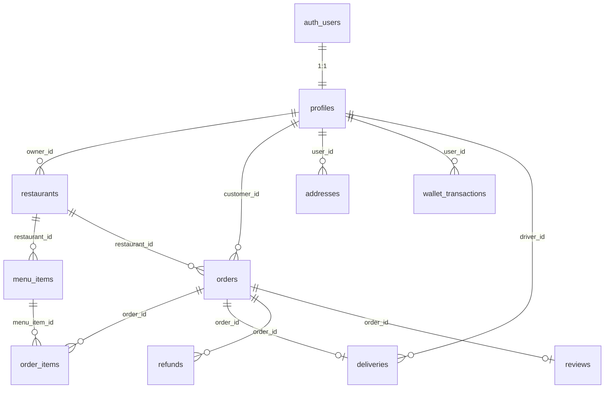

# Deligro — Database Reference

Quick reference for the **Supabase (Postgres)** schema used by the Next.js app.  
Source of truth: [`supabase/migrations/`](../supabase/migrations/) (`0001` → `0007`).

---

## Connection

| Env variable | Purpose |
|--------------|---------|
| `NEXT_PUBLIC_SUPABASE_URL` | Project URL |
| `NEXT_PUBLIC_SUPABASE_PUBLISHABLE_KEY` or `NEXT_PUBLIC_SUPABASE_ANON_KEY` | Browser + RLS-enforced server reads |
| `SUPABASE_SECRET_KEY` or `SUPABASE_SERVICE_ROLE_KEY` | Server-only scripts (bypasses RLS) |

- **Dashboard:** Supabase → your project → Table Editor / SQL Editor  
- **Live counts in app:** `/build`  
- **Never commit** `.env.local`

---

## Enums

| Enum | Values | Used in |
|------|--------|---------|
| `user_role` | `customer`, `restaurant`, `driver`, `admin` | `profiles.role` |
| `order_status` | `placed`, `kitchen`, `ready`, `on_the_way`, `delivered`, `cancelled` | `orders.status` |
| `delivery_status` | `unassigned`, `assigned`, `picked_up`, `delivered`, `cancelled`, `failed` (`0081`) | `deliveries.status` |
| `refund_status` | `pending`, `approved`, `denied` | `refunds.status` |

### Order status flow (vendor / driver / customer)

```
placed → kitchen → ready → on_the_way → delivered
   ↘ cancelled (vendor or admin)
```

| Legacy PHP status | Supabase `order_status` |
|-------------------|-------------------------|
| ORDER PLACED | `placed` |
| ORDER PROCESSED | `kitchen` |
| ORDER PICKED UP | `on_the_way` |
| ORDER DELIVERED | `delivered` |
| ORDER CANCELED | `cancelled` |

---

## Entity relationship (overview)



---

## Tables

### `auth.users` (Supabase Auth — not in `public`)

Managed by Supabase Auth. Each row gets a matching `profiles` row via trigger `on_auth_user_created`.

| Field (common) | Notes |
|----------------|-------|
| `id` | UUID — same as `profiles.id` |
| `email` | Login email |
| `phone` | Optional; used for OTP login |

---

### `profiles`

One row per authenticated user. **`role` is the authorization source of truth.**

| Column | Type | Default | Notes |
|--------|------|---------|-------|
| `id` | `uuid` PK | — | FK → `auth.users(id)` ON DELETE CASCADE |
| `role` | `user_role` | `customer` | Only admin/service-role can change (trigger `lock_role`) |
| `full_name` | `text` | null | |
| `phone` | `text` | null | Unique when set (partial index) |
| `wallet_balance` | `numeric(10,2)` | `0` | Added in `0006` |
| `onesignal_id` | `text` | null | OneSignal player id for push (`0007`) |
| `created_at` | `timestamptz` | `now()` | |

**RLS:** User reads/updates own row; admin reads all.

**App roles → routes**

| `role` | Portal |
|--------|--------|
| `customer` | `/`, `/checkout`, `/orders` |
| `restaurant` | `/vendor`, `/vendor/menu`, `/vendor/earnings` |
| `driver` | `/driver` |
| `admin` | `/admin` |

---

### `restaurants`

A shop / restaurant listing. Vendor account = `profiles` where `role = 'restaurant'` and `restaurants.owner_id = profiles.id`.

| Column | Type | Default | Notes |
|--------|------|---------|-------|
| `id` | `uuid` PK | `gen_random_uuid()` | |
| `owner_id` | `uuid` | — | FK → `profiles(id)` |
| `slug` | `text` UNIQUE | — | URL: `/restaurant/[slug]` |
| `name` | `text` | — | Display name |
| `tagline` | `text` | null | |
| `is_open` | `boolean` | `true` | Vendor toggle (`/vendor` header) |
| `approved` | `boolean` | `false` | Must be true for customer browse (unless owner) |
| `image_url` | `text` | null | Cover image (`0002`) |
| `accent_tint` | `text` | null | CSS gradient fallback |
| `cuisines` | `text[]` | `{}` | e.g. `{"Fast Food","North Indian"}` |
| `rating` | `numeric(2,1)` | `4.5` | |
| `rating_count` | `integer` | `0` | |
| `eta_min` | `integer` | null | Minutes |
| `eta_max` | `integer` | null | Minutes |
| `price_tier` | `smallint` | `2` | 1 = ₹, 2 = ₹₹, 3 = ₹₹₹ |
| `cost_for_two` | `integer` | null | Whole rupees |
| `distance_km` | `numeric(4,1)` | null | |
| `offer` | `text` | null | Promo line on card |
| `promoted` | `boolean` | `false` | Home feed boost |
| `created_at` | `timestamptz` | `now()` | |

**Indexes:** `owner_id`

**Legacy PHP mapping:** `shop` table → `restaurants`  
**Legacy slug pattern:** `shop-name-{legacy_shop_id}` e.g. `burger-republic`, `chhitiz-swad-restaurant-126`

**RLS:** Customers read `approved = true`; owners read/manage own rows; admin all.

**DAL:** [`src/lib/data-access/restaurants.ts`](../src/lib/data-access/restaurants.ts), [`vendor-restaurant.ts`](../src/lib/data-access/vendor-restaurant.ts)

---

### `menu_items`

| Column | Type | Default | Notes |
|--------|------|---------|-------|
| `id` | `uuid` PK | `gen_random_uuid()` | |
| `restaurant_id` | `uuid` | — | FK → `restaurants(id)` |
| `name` | `text` | — | |
| `description` | `text` | null | |
| `price` | `integer` | — | **Whole rupees** (₹), ≥ 0 |
| `veg` | `boolean` | `true` | |
| `available` | `boolean` | `true` | `false` = sold out on customer UI |
| `external_id` | `text` | null | Legacy import id e.g. `legacy-260` |
| `category` | `text` | null | e.g. `Burgers`, `Popular` |
| `image_url` | `text` | null | |
| `popular` | `boolean` | `false` | |
| `bestseller` | `boolean` | `false` | |
| `sort_order` | `integer` | `0` | Vendor display order (`0009`) |
| `created_at` | `timestamptz` | `now()` | |

**Unique:** `(restaurant_id, external_id)` where `external_id` is not null

**Storage:** public bucket `menu-images` — object path `{restaurant_id}/{filename}`; owners write via `owns_restaurant()` (`0009`)

**Legacy PHP mapping:** `products` → `menu_items` (`status ON/OFF` → `available`)

**RLS:** Public read for approved restaurants; owner CRUD via `owns_restaurant()`.

**DAL:** [`vendor-menu.ts`](../src/lib/data-access/vendor-menu.ts)

---

### `orders`

| Column | Type | Default | Notes |
|--------|------|---------|-------|
| `id` | `uuid` PK | `gen_random_uuid()` | |
| `customer_id` | `uuid` | — | FK → `profiles(id)` |
| `restaurant_id` | `uuid` | — | FK → `restaurants(id)` |
| `status` | `order_status` | `placed` | See enum flow above |
| `total` | `integer` | `0` | **Server-computed** (items + fees), ≥ 0 |
| `delivery_fee` | `integer` | `0` | Whole rupees (`0002`) |
| `tax_amount` | `integer` | `0` | Whole rupees (`0002`) |
| `address` | `jsonb` | null | See shape below |
| `pickup_otp` | `text` | random 4-digit | Restaurant handover (`0006`) |
| `delivery_otp` | `text` | random 4-digit | Rider handover (`0006`) |
| `discount` | `integer` | `0` | Rupees off the grand total. Written only by `apply_coupon_to_order()` (`0031`) |
| `coupon_code` | `text` | null | Snapshot of the code used; no FK, so deleting a coupon can't rewrite history (`0031`) |
| `channel` | `text` | `'app'` | `app` \| `phone` — how the order was taken (`0029`) |
| `placed_by` | `uuid` | null | FK → `profiles(id)` SET NULL. The operator who took a phone order; null for an app order (`0029`) |
| `delivery_instructions` | `text` | null | The customer's note to the rider, ≤ 300 chars (CHECK). Granted to `authenticated` by column; locked by `guard_order_update`; written by the service role (`0082`) |
| `created_at` | `timestamptz` | `now()` | |

> This column list is not exhaustive past `0012`: `tip` (`0013`),
> `external_id` (`0015`), `payment_method` / `payment_status` (`0025`) and
> `accepted_at` / `ready_at` / `cancelled_at` (`0026`) are also on this table.
> Read the migrations for the full shape.
>
> `0061` adds `preparing_at` (`timestamptz`, null while merely accepted; stamped
> only by `start_preparing(order_id)`, which checks the caller owns the shop and
> the order is `kitchen`) and `prep_minutes` (`smallint` 1–180, the prep time
> promised on accept; a kitchen may change it only while `placed`/`kitchen`).
> The Partner app reads `kitchen` + `preparing_at` null as **Accepted** and
> `kitchen` + `preparing_at` set as **Preparing**.

### Shop hours, stock, variants and add-ons (`0062`)

- **Is the shop open?** `restaurant_status_now(restaurant_id, at default now())` →
  `open` | `closed` (owner switched it off) | `temporarily_closed` (`closed_until`
  ahead) | `holiday` (`store_holidays` covers today) | `weekly_off` | `outside_hours`
  (`opening_time`/`closing_time`; closing before opening means past midnight). IST.
  `restaurant_open_statuses(ids uuid[])` answers many at once for storefronts. Order
  placement refuses a line unless the status is `open`.
- **`store_holidays`** — `restaurant_id`, `starts_on`, `ends_on` (inclusive dates), `note`.
  Readable like the menu; owner/admin write.
- **`menu_items`** gains `stock_qty` (null = untracked), `low_stock_at`,
  `sold_out_by_stock`, `available_days` (smallint[] 0 = Sunday; null = every day),
  `available_from` / `available_to` (time; reversed = past midnight). Stock goes down
  when an order line is inserted and back on cancellation (SECURITY DEFINER triggers);
  at 0 the dish turns sold out, and restocking reverses only that.
- **`menu_item_variants`** (`menu_item_id`, `name`, `price` absolute, `available`,
  `sort_order`), **`menu_item_addon_groups`** (`menu_item_id`, `name`, `min_select`,
  `max_select`), **`menu_item_addons`** (`group_id`, `name`, `price`, `available`).
  Readable like the menu; the dish's owner writes.
- **`order_items.options`** — the client inserts `{"variantId", "addonIds": []}`; the
  guard replaces it with a snapshot `{"variant": {id,name,price}|null, "addons":
  [{id,name,price,group}]}` and sets `price` = variant price (or the dish's effective
  price) + add-ons, and `name` = "Dish (Variant)". A dish with any available variant
  requires one.

### Invoice numbers (`0063`)

- **`orders.invoice_no`** / **`invoice_at`** — stamped by the `assign_invoice_no`
  trigger (SECURITY DEFINER, named `orders_zz_…` so it runs after
  `orders_guard_update`) when an order's status first reaches `on_the_way` or
  `delivered`. Format `INV/<FY>/<00001>`, numbered **per shop per Indian financial
  year** (April–March, IST, `invoice_fy(at)`), gapless: the counter row in
  `invoice_counters (restaurant_id, fy, last_no)` is bumped in the same transaction,
  so a rolled-back status change hands its number back. Unique per shop. Clients read
  the two columns (per-column grant) but can never write them (`guard_order_update`
  locked list). `invoice_counters` has RLS on and no client grants. The migration
  backfills orders already past the kitchen, in the order they were placed.

### Growth and support (`0064`)

- **`coupons.starts_at`** — a code starts working at that instant (null = straight
  away); `price_coupon()` answers `not_started` before it, so preview and redemption
  both refuse. `refresh_restaurant_offer()` ignores codes that haven't started;
  `refresh_due_offers()` (service role, called by the dispatch sweep) puts the shop
  badge up once they have.
- **`marketing_requests`** (`restaurant_id`, `requested_by`, `kind` featured / banner /
  discount_offer / festival_campaign / sponsored_product, `title`, `details`, `budget`,
  `starts_on`, `ends_on`, `status` pending → approved / in_progress → completed, or
  rejected / cancelled, `admin_remarks`) and **`marketing_request_updates`** (every
  status change with remarks and who made it). The shop's owner and admins read; only
  the server writes.
- **`support_tickets`** / **`support_messages`** — the shared shape the Rider plan
  (0087) and the Manager branch (0143) also create (`create table if not exists`, so
  the first applied wins and the rest converge). Requesters read their own tickets and
  only non-internal messages; admins read all; only the server writes. Private bucket
  `support-attachments` (5 MB, jpeg/png), read through signed URLs.
- **`user_notifications`** (`user_id`, `role`, `category`, `title`, `body`, `data`,
  `read_at`) — the in-app inbox; every vendor push writes one. The user reads their
  own and may update only `read_at`.
- **`announcements`** (`audience` vendor / rider / manager / all, `title`, `body`,
  `starts_at`, `ends_at`) — readable while live by signed-in users of that audience
  (`announcement_audience_of()`: a shop owner counts as a vendor); admins write.

### `order_status_events` (`0061`)

One row per status change (`kind = 'status'`, written by the
`log_order_status_event` trigger on insert and on every `status` change) and per
Preparing step (`kind = 'preparing'`, written by `start_preparing`).

| Column | Type | Notes |
|--------|------|-------|
| `id` | `bigint` identity PK | |
| `order_id` | `uuid` | FK → `orders(id)` cascade |
| `restaurant_id` | `uuid` | Copied from the order, for the read policy |
| `kind` | `text` | `status` \| `preparing` |
| `from_status` / `to_status` | `order_status` | `from_status` null for the order being placed |
| `actor_id` | `uuid` | `auth.uid()` of whoever made the change; null for service-role writes |
| `reason` | `text` | The cancellation reason when `to_status = 'cancelled'` |
| `created_at` | `timestamptz` | |

**RLS:** shop owner, the order's customer and admins read; nobody writes
through the API (insert/update/delete revoked from `anon`/`authenticated`).

**`address` JSON shape**

`line` is the full findable address, not a summary: checkout concatenates the
saved street line with the apartment, entry code, floor, building name and
courier note. It is what the rider's board prints and what `mapsDirectionsUrl`
geocodes when the pin is absent. `lat`/`lng` are the delivery pin — optional
(an address saved before the map picker has none), and what the 500 m arrival
notification measures against.

```json
{
  "label": "Home",
  "line": "402, Ashirwad Residency, Koramangala 5th Block, Bengaluru, Gate 2",
  "lat": 21.7157,
  "lng": 81.5335
}
```

Optional `lat` / `lng` may be added from map picker.

**Indexes:** `customer_id`, `restaurant_id`

**RLS:** Customer own orders; restaurant own `restaurant_id`; driver assigned active delivery; manager read + advance `status` (`0023`); admin all.

**INSERT** is `customer_id = auth.uid()` plus a role in (`customer`,
`admin`) — admin joined as of `0040` so the owner's own account, which is an
admin, can shop through the customer app. It inserts as *itself*; posting an
order in another person's name is still the phone-order path below. Because
admin reads every row, customer-facing screens ask `listMyOrders()`
(`customer_id = me`) rather than leaning on RLS to scope the list.

**Column guard:** `guard_order_update()` — anyone who is not admin or the
service role may move `status` and nothing else. `channel`, `placed_by`,
`discount`, `coupon_code` and (`0082`) `delivery_instructions` are on that locked list. It is **SECURITY INVOKER**
as of `0030`, deliberately: as DEFINER it read its own owner as `current_user`
and could not tell a trusted server function from a customer, which is the
whole job. `total` is also pinned at INSERT (`0030`), so it cannot be posted
directly.

**No manager INSERT policy — on purpose.** Phone orders are written by
`placePhoneOrder()` through the service role, which stamps `placed_by`. See
SECURITY.md → "Manager".

**DAL:** [`orders.ts`](../src/lib/data-access/orders.ts), [`vendor-orders.ts`](../src/lib/data-access/vendor-orders.ts), [`admin-orders.ts`](../src/lib/data-access/admin-orders.ts), [`manager-orders.ts`](../src/lib/data-access/manager-orders.ts), [`manager-phone-orders.ts`](../src/lib/data-access/manager-phone-orders.ts)

**Vendor board filters:** `status IN ('placed','kitchen','ready')` for active kitchen columns.

---

### `order_items`

Line items snapshotted at order time (price/name frozen even if menu changes).

| Column | Type | Default | Notes |
|--------|------|---------|-------|
| `id` | `uuid` PK | `gen_random_uuid()` | |
| `order_id` | `uuid` | — | FK → `orders(id)` CASCADE |
| `menu_item_id` | `uuid` | null | FK → `menu_items(id)` SET NULL |
| `name` | `text` | — | Snapshot |
| `qty` | `integer` | — | > 0 |
| `price` | `integer` | — | Unit price snapshot, whole rupees |

**Index:** `order_id`

**RLS:** Visibility follows parent order.

---

### `deliveries`

One delivery row per order (1:1, enforced by the UNIQUE on `order_id`).

Since `0042` the row can exist **before** anybody is carrying the order: dispatch
writes an `unassigned` row holding an offer the moment the vendor accepts. Code
that asks "does this order have a rider?" must therefore test `driver_id` (or
`status <> 'unassigned'`), never the mere existence of the row.

| Column | Type | Default | Notes |
|--------|------|---------|-------|
| `id` | `uuid` PK | `gen_random_uuid()` | |
| `order_id` | `uuid` UNIQUE | — | FK → `orders(id)` |
| `driver_id` | `uuid` | null | FK → `profiles(id)`. Null until a rider **accepts** |
| `status` | `delivery_status` | `unassigned` | |
| `assigned_at` | `timestamptz` | null | |
| `picked_up_at` | `timestamptz` | null | Start of the road leg (`0008`) |
| `delivered_at` | `timestamptz` | null | |
| `driver_lat` | `double precision` | null | Last reported fix (`0008`) |
| `driver_lng` | `double precision` | null | (`0008`) |
| `driver_location_at` | `timestamptz` | null | When that fix arrived (`0008`) |
| `driver_location_source` | `text` | null | `gps` \| `none`. Null/`none` = the customer's map is showing an interpolation and must say so (`0026`) |
| `offered_driver_id` | `uuid` | null | FK → `profiles(id)` SET NULL. Who dispatch picked — a first refusal, **not** an assignment (`0042`) |
| `offered_at` | `timestamptz` | null | Start of the exclusivity window (`EXCLUSIVE_OFFER_MS`, `0042`) |
| `arrival_notified_at` | `timestamptz` | null | Once-only latch behind the 500 m "your rider is here" push (`0042`) |
| `cod_collected_amount` | `integer` | null | Rupees the rider confirmed collecting at the door, for a cash-on-delivery order. Written once, when the order is marked delivered (`0047`) |
| `cod_collected_at` | `timestamptz` | null | When the collection was recorded (`0047`) |
| `arrived_pickup_at` | `timestamptz` | null | Rider reached the shop. Set once (`0081`) |
| `departed_pickup_at` | `timestamptz` | null | Rider left the shop with the order. Set once (`0081`) |
| `arrived_drop_at` | `timestamptz` | null | Rider reached the customer. Set once (`0081`) |
| `failed_at` | `timestamptz` | null | Stamped by the guard on `-> failed` (`0081`) |
| `failure_reason` | `text` | null | Required for `failed` (`0081`) |
| `pickup_method` | `text` | null | `code` \| `qr` \| `vendor` \| `manual` \| `none`: how the pickup was proved (`0081`) |
| `delivery_method` | `text` | null | `code` \| `photo` \| `ops_approved` \| `staff`: how the delivery was proved (`0081`) |
| `distance_km` | `numeric(6,2)` | null | Route distance shop -> customer, >= 0 (`0081`) |
| `last_action_id` | `uuid` | null | Rider app's per-tap id; copied to `delivery_events.client_action_id` so a replayed tap fails with 23505 (`0081`) |
| `correction_reason` | `text` | null | Staff paths only. Changing it makes the update a **correction** (`0081`) |
| `pod_photo_path` | `text` | null | Proof-of-delivery photo: object path in the private `delivery-proofs` bucket, served only via short-lived signed URLs (`0082`) |
| `distance_source` | `text` | null | How `distance_km` was computed: `road` (routing server) \| `estimate` (straight line x 1.3, upgraded to `road` after acceptance when routing answers) (`0082`) |

**Index:** `driver_id`; partial index on `offered_driver_id` (`0042`)

**Triggers (`0081`):**

- `guard_delivery_transition` (BEFORE UPDATE, every role **including
  service_role**). A correction (an update that changes `correction_reason`)
  relaxes rules 1, 4 and 5 only. (1) `-> delivered` needs `picked_up_at`;
  stamps `delivered_at`. (2) `-> picked_up` needs old status `assigned` and a
  `driver_id`; stamps `picked_up_at`. (3) `-> failed` needs a non-blank
  `failure_reason` and old status `assigned`/`picked_up`; stamps `failed_at`.
  (4) `arrived_pickup_at`, `departed_pickup_at`, `arrived_drop_at`,
  `picked_up_at` cannot change once set. (5) nothing leaves `delivered`,
  `failed`, `cancelled`. Violations raise `invalid_delivery_transition`
  (SQLSTATE 23514, the broken rule in DETAIL).
  **`0082` adds** (re-declaring the function; corrections bypass 6–9):
  (6) `-> delivered` also needs old status `picked_up`. (7) `-> failed` needs
  an **approved** `failed_delivery`, `customer_unreachable` or `wrong_address`
  exception for this delivery and its current rider. (8) `delivery_method`
  becoming `ops_approved` needs an approved `complete_without_code`. (9)
  `pickup_method` becoming `manual` needs an approved `manual_pickup`. (10) A
  **release** (`driver_id` non-null → null) must be a correction, must land on
  `unassigned`, must come out of `assigned` (not `picked_up` — the rider has
  the food — nor a terminal status), and clears `assigned_at`, the
  four arrival/pickup/departure stamps and `pickup_method` so the next rider can
  set them; it also clears `offered_driver_id` / `offered_at`. Each release
  carries its own `correction_reason` (`released:<why>:<id>`). (11) Rules 7–9
  count an approval only if it was raised during the current assignment
  (`created_at >= assigned_at`), and a non-correction update that gives the job
  to a rider stamps `assigned_at = now()` so both sides are the database's
  clock. The exception lookup runs as the writer (SECURITY INVOKER) — the
  service role, admins and managers read every exception.
- `guard_delivery_insert` (BEFORE INSERT, every role, `0082`): outside a
  correction (`correction_reason` set), a new delivery is `unassigned`, or
  `assigned` with a `driver_id`, and carries no `picked_up_at`, `delivered_at`,
  `failed_at`, `pickup_method` or `delivery_method`; `assigned_at` is stamped
  `now()` when it has a rider. Raises `invalid_delivery_transition` (23514).
- `log_delivery_event` (AFTER INSERT OR UPDATE, SECURITY DEFINER) writes
  `delivery_events` rows: `offered`, `accepted`, `reassigned`,
  `arrived_pickup`, `picked_up` (+method), `departed`, `arrived_drop`,
  `delivered` (+method), `failed` (+reason), `cancelled`, `corrected` (+reason).
  Since `0082` a reassignment writes `reassigned` (the rider who lost it)
  **and** `accepted` (the rider who took it), and a release writes `released`
  (the rider who lost it, + the correction reason).
- `log_delivery_withdrawn` (AFTER DELETE, when the row was `unassigned` with
  an `offered_driver_id`, SECURITY DEFINER, `0082`) writes `withdrawn` for the
  offered rider, so every `offered` row has an outcome. Nothing is written when
  the order itself is being deleted.
- `mark_delivery_action` (BEFORE UPDATE OF `last_action_id`) tells the logger
  that the update set the id itself, so a replay of the same id is caught while
  a later write that merely leaves the old id on the row is not. The id goes on
  the first event of the update only.
- `record_rider_earning` (AFTER UPDATE, when `status` **becomes**
  `delivered`, SECURITY DEFINER, `0083`) writes the delivery's
  `rider_earnings` row from the rate card in force at that moment,
  `on conflict (delivery_id) do nothing` — a correction that takes the row out
  of `delivered` and back never pays twice. See `rider_earnings`.

The staff path (`recordCodForStaffDelivery`) is a correction
(`correction_reason = 'staff_marked_delivered'`, `delivery_method = 'staff'`).

**RLS:** unchanged by `0042` — `driver_id = auth.uid()`, the owning vendor, or
admin. The offered rider is deliberately *not* admitted: see the header of
`0042_rider_dispatch.sql` for why that clause would leak one rider's live
position to another. The driver board reads this table service-role behind
`requireRole("driver")`.

**DAL:** [`driver-orders.ts`](../src/lib/data-access/driver-orders.ts),
[`rider-dispatch.ts`](../src/lib/dispatch/rider-dispatch.ts)

---

### `refunds`

| Column | Type | Default | Notes |
|--------|------|---------|-------|
| `id` | `uuid` PK | `gen_random_uuid()` | |
| `order_id` | `uuid` | — | FK → `orders(id)` |
| `amount` | `integer` | — | Whole rupees |
| `reason` | `text` | null | |
| `status` | `refund_status` | `pending` | |
| `decided_by` | `uuid` | null | FK → `profiles(id)` admin |
| `created_at` | `timestamptz` | `now()` | |

**RLS:** Customer request + read own; admin approve/deny. Since `0061` the shop
owner also reads refunds on their own orders ("refunds — vendor read"), which
`vendor-earnings.ts` needs.

---

### `settlement_corrections`

A debit against a vendor's future settlement, created when a refund is
approved for an order whose payout was already paid out. Closes the gap the
codebase's own comments used to name directly: `flagSettlementForRefund()`
said "there is no automatic clawback", and `voidSettlement()` still refuses to
reverse a paid batch with "record a correction instead" (`0048`).

| Column | Type | Default | Notes |
|--------|------|---------|-------|
| `id` | `uuid` PK | `gen_random_uuid()` | |
| `restaurant_id` | `uuid` | — | FK → `restaurants(id)` |
| `order_id` | `uuid` | — | FK → `orders(id)` |
| `refund_id` | `uuid` | null | FK → `refunds(id)` SET NULL |
| `original_settlement_id` | `uuid` | — | FK → `vendor_settlements(id)`. The settlement that paid the vendor for this order in the first place |
| `applied_settlement_id` | `uuid` | null | FK → `vendor_settlements(id)` SET NULL. The settlement that actually recovered it, once one exists |
| `amount` | `integer` | — | Whole rupees to recover, > 0. Computed from the drop in the order's settlement `contribution` once the refund is included, via the same `lineFor()` arithmetic every other settlement figure uses, never invented |
| `reason` | `text` | null | |
| `status` | `correction_status` | `outstanding` | `outstanding` \| `applied` \| `voided` |
| `created_by` | `uuid` | — | FK → `profiles(id)`, the admin who approved the triggering refund |
| `created_at` | `timestamptz` | `now()` | |
| `applied_at` | `timestamptz` | null | |

A draft (not yet paid) settlement never needs a row here: voiding and
rebuilding it prices a late-landing refund correctly through the normal
per-line arithmetic, since the order simply re-enters the next preview. This
table exists only for money that has already left the building — a refund
approved after a **paid** settlement.

**Applied automatically:** every outstanding correction for a vendor is netted
into `net_payable` the next time a settlement (draft or instant) is written
for them, and marked `applied` with a trace to that settlement
(`writeSettlement()` in `admin-settlements.ts`). Voiding a settlement that had
absorbed a correction reverts it to `outstanding`.

**RLS:** Admin read only — a manager has no role in vendor settlements
anywhere else in this schema (`0023`), so this table does not extend that
grant. No insert, update or delete policy for any authenticated role: every
write goes through the service role, reached only behind
`requireRole("admin")`, the same shape as `vendor_settlements` itself.

**DAL:** [`admin-settlements.ts`](../src/lib/data-access/admin-settlements.ts) (`createSettlementCorrection`, `outstandingCorrectionsFor`), consumed from [`refunds.ts`](../src/lib/data-access/refunds.ts)

---

### `addresses`

Saved customer delivery addresses.

| Column | Type | Default | Notes |
|--------|------|---------|-------|
| `id` | `uuid` PK | `gen_random_uuid()` | |
| `user_id` | `uuid` | — | FK → `profiles(id)` |
| `label` | `text` | `'Home'` | e.g. Home, Work |
| `line` | `text` | — | Full address string |
| `lat` | `double precision` | null | |
| `lng` | `double precision` | null | |
| `is_default` | `boolean` | `false` | Only one default per user (trigger) |
| `created_at` | `timestamptz` | `now()` | |

**API:** `GET/PATCH/DELETE /api/addresses`, `POST /api/addresses`

---

### `reviews`

| Column | Type | Default | Notes |
|--------|------|---------|-------|
| `id` | `uuid` PK | `gen_random_uuid()` | |
| `order_id` | `uuid` UNIQUE | — | One review per order |
| `user_id` | `uuid` | — | FK → `profiles(id)` |
| `restaurant_id` | `uuid` | — | FK → `restaurants(id)` |
| `rating` | `integer` | — | 1–5 |
| `comment` | `text` | null | |
| `created_at` | `timestamptz` | `now()` | |

**RLS:** Public read; customer insert only on own **delivered** order.

**API:** `POST /api/reviews`

---

### `wallet_transactions`

| Column | Type | Default | Notes |
|--------|------|---------|-------|
| `id` | `uuid` PK | `gen_random_uuid()` | |
| `user_id` | `uuid` | — | FK → `profiles(id)` |
| `amount` | `numeric(10,2)` | — | Positive = credit, negative = debit |
| `reason` | `text` | — | |
| `order_id` | `uuid` | null | FK → `orders(id)` |
| `created_at` | `timestamptz` | `now()` | |

**RLS:** User read own; writes are **service-role only** (client cannot credit self).

---

### `cod_handovers`

Digital record of one leg of the cash-on-delivery handover chain: Customer to
rider, rider to manager, manager to owner. The cash itself can move offline;
this table is what makes that movement auditable, per the confirmed rule that
offline execution must never mean an untracked transaction (`0047`).

| Column | Type | Default | Notes |
|--------|------|---------|-------|
| `id` | `uuid` PK | `gen_random_uuid()` | |
| `leg` | `cash_handover_leg` | — | `rider_to_manager` \| `manager_to_owner` |
| `from_user` | `uuid` | null | FK → `profiles(id)` SET NULL |
| `to_user` | `uuid` | null | FK → `profiles(id)` SET NULL |
| `amount` | `integer` | — | Whole rupees, >= 0 |
| `handover_date` | `date` | `current_date` | Set from IST at write time by the app, not left to the server's own time zone |
| `note` | `text` | null | |
| `recorded_by` | `uuid` | — | FK → `profiles(id)`. Who entered the row, not always `from_user` or `to_user` |
| `created_at` | `timestamptz` | `now()` | |

Not tied to individual orders: a rider hands over a shift's cash in one
amount, not order by order. Reconciling a handover total against
`deliveries.cod_collected_amount` for the same period is shown side by side on
`/admin/cash-ledger`, but is not enforced.

**RLS:** Admin and manager read all rows. No insert, update or delete policy
for any authenticated role: every write goes through the service role from
[`cod-handovers.ts`](../src/lib/data-access/cod-handovers.ts), behind
`requireRole(["manager", "admin"])`, the same shape as `vendor_settlements`
(`0028`). Never updated after creation; a correction is a new row.

**DAL:** [`cod-handovers.ts`](../src/lib/data-access/cod-handovers.ts)

**UI:** `/manager/cash` (record), `/admin/cash-ledger` (owner's view)

---

### `operational_expenses`

A Deligro cost recorded here, whatever the underlying payment channel. Not an
accounts-payable system: no invoices, no approval workflow, no payment
execution. Rider salary, EV bike maintenance and charging, and other small
operational spend can be paid however is practical for a single tier-3 city;
this table is only the digital record that the cost happened (`0047`).

| Column | Type | Default | Notes |
|--------|------|---------|-------|
| `id` | `uuid` PK | `gen_random_uuid()` | |
| `category` | `expense_category` | — | `rider_salary` \| `ev_bike_maintenance` \| `ev_bike_charging` \| `rider_other` \| `small_expense` \| `other` |
| `amount` | `integer` | — | Whole rupees, >= 0 |
| `driver_id` | `uuid` | null | FK → `profiles(id)` SET NULL. Named to match `deliveries.driver_id`; the product calls this role "rider" everywhere above the schema. Set only when the expense is tied to one rider |
| `payment_method` | `expense_payment_method` | `offline_cash` | `offline_cash` \| `offline_bank` \| `upi` \| `other` |
| `expense_date` | `date` | `current_date` | Set from IST at write time by the app |
| `note` | `text` | null | |
| `recorded_by` | `uuid` | — | FK → `profiles(id)` |
| `created_at` | `timestamptz` | `now()` | |

Every amount here classifies as a **Deligro cost**, never revenue. EV bike
allocation (which bike belongs to which rider) is deliberately not tracked
here; it stays an offline register by design. Only the rupee amount, when one
is financially material, gets a record.

**RLS:** Same shape as `cod_handovers`: admin and manager read all rows,
service-role-only writes behind `requireRole(["manager", "admin"])`.

**DAL:** [`operational-expenses.ts`](../src/lib/data-access/operational-expenses.ts)

**UI:** `/manager/cash` (record), `/admin/cash-ledger` (owner's view)

---

### `coupons`

| Column | Type | Default | Notes |
|--------|------|---------|-------|
| `code` | `text` PK | — | e.g. `WELCOME50` |
| `kind` | `text` | — | `percent` or `flat` |
| `value` | `numeric(10,2)` | — | % or flat ₹ amount |
| `min_order` | `numeric(10,2)` | `0` | Minimum cart |
| `max_discount` | `numeric(10,2)` | null | Cap for percent coupons |
| `active` | `boolean` | `true` | |
| `expires_at` | `timestamptz` | null | |
| `created_at` | `timestamptz` | `now()` | |

**Seed coupons:** `WELCOME50`, `FLAT30` (in migration `0006`)

**API:** `POST /api/coupons/validate`

---

### `otp_codes`

Server-only OTP storage for phone login. **No RLS policies** — only service-role can access.

| Column | Type | Default | Notes |
|--------|------|---------|-------|
| `id` | `uuid` PK | `gen_random_uuid()` | |
| `phone` | `text` | — | E.164 e.g. `+919876543210` |
| `code_hash` | `text` | — | `sha256(code + phone + pepper)` |
| `attempts` | `integer` | `0` | Lock after too many wrong tries |
| `consumed` | `boolean` | `false` | |
| `expires_at` | `timestamptz` | — | |
| `created_at` | `timestamptz` | `now()` | |

**API:** `POST /api/auth/otp/request`, `POST /api/auth/otp/verify`

---

### `rider_status`

One row per rider who has ever gone online (`0081`). No row = offline.

| Column | Type | Default | Notes |
|--------|------|---------|-------|
| `driver_id` | `uuid` PK | — | FK → `profiles(id)` CASCADE |
| `is_online` | `boolean` | `false` | |
| `break_until` | `timestamptz` | null | On a break until then; dispatch skips the rider, the shift continues |
| `online_since` | `timestamptz` | null | |
| `last_lat` / `last_lng` | `double precision` | null | Last fix |
| `last_fix_at` | `timestamptz` | null | A stale fix takes the rider out of dispatch |
| `updated_at` | `timestamptz` | `now()` | |

### `rider_shifts`

One row per online session, for hours and attendance (`0081`).

| Column | Type | Default | Notes |
|--------|------|---------|-------|
| `id` | `bigint` identity PK | | |
| `driver_id` | `uuid` | — | FK → `profiles(id)` CASCADE |
| `started_at` | `timestamptz` | — | |
| `ended_at` | `timestamptz` | null | >= `started_at` |
| `ended_by` | `text` | null | `rider` \| `logout` \| `ops` \| `presence` |

**Index:** `(driver_id, started_at desc)`; unique partial `(driver_id) where ended_at is null`, so one open shift per rider.

### `rider_profiles`

Rider-only profile data (`0081`); later phases add columns.

| Column | Type | Default | Notes |
|--------|------|---------|-------|
| `driver_id` | `uuid` PK | — | FK → `profiles(id)` CASCADE |
| `rider_code` | `text` UNIQUE | `next_rider_code()` | `DR-0001`, `DR-0002`, … from `rider_code_seq`, in registration order; never reused, not truncated past 9999 |
| `created_at` / `updated_at` | `timestamptz` | `now()` | |

Trigger `ensure_rider_profile` on `profiles` (AFTER INSERT OR UPDATE OF `role`,
when `role = 'driver'`, SECURITY DEFINER) creates the row; existing drivers were
backfilled in `profiles.created_at` order.

### `delivery_events`

Append-only audit of every delivery step (`0081`, §17.5). Written by
`log_delivery_event` and the service-role data layer; never updated.

| Column | Type | Default | Notes |
|--------|------|---------|-------|
| `id` | `bigint` identity PK | | |
| `delivery_id` | `uuid` | — | **No FK** on purpose: dispatch deletes cancelled offer rows and their history must survive |
| `order_id` | `uuid` | — | FK → `orders(id)` CASCADE |
| `driver_id` | `uuid` | null | FK → `profiles(id)` SET NULL. The rider the event concerns: the offered rider for `offered`, the rider who lost the job for `reassigned` |
| `kind` | `text` | — | `offered`, `rejected`, `lapsed`, `accepted`, `arrived_pickup`, `picked_up`, `departed`, `arrived_drop`, `delivered`, `failed`, `cancelled`, `reassigned`, `exception_requested`, `exception_decided`, `corrected`; `0082`: `contact_attempt`, `released`, `withdrawn` |
| `method` / `reason` | `text` | null | `contact_attempt` requires method `customer` \| `vendor` (`0082`) |
| `actor_id` | `uuid` | null | FK → `profiles(id)` SET NULL. `auth.uid()` of the writer; null for the service role |
| `lat` / `lng` | `double precision` | null | The delivery's last rider fix at the time |
| `client_action_id` | `uuid` | null | Unique where not null |
| `created_at` | `timestamptz` | `now()` | |

**Index:** unique `client_action_id` (partial); `(delivery_id, created_at)`; `(driver_id, created_at desc)`.

**RLS (all four rider tables):** a rider SELECTs their own rows
(`driver_id = auth.uid()`); admins and managers read all. No write policy, and
INSERT/UPDATE/DELETE are revoked from `anon`/`authenticated`. Writes go through
the service role behind `requireRole()`, or through the triggers.

### `platform_settings`: legal links (`0081`)

`privacy_policy_url` and `terms_url` (`text not null default ''`, CHECK: empty
or `https://`). Granted by column to `anon`/`authenticated` (the row is
column-granted since `0032`). Empty means nothing is published and the apps
hide the link. Edited on Admin → Settings → Support and brand.

### `delivery_exceptions`

What a rider raises on a job (`0082`). Written only by the service role.

| Column | Type | Default | Notes |
|--------|------|---------|-------|
| `id` | `uuid` PK | `gen_random_uuid()` | |
| `delivery_id` | `uuid` | — | FK → `deliveries(id)` CASCADE |
| `order_id` | `uuid` | — | No FK (the delivery carries the cascade) |
| `driver_id` | `uuid` | — | The rider who raised it. No FK |
| `kind` | `text` | — | **Requests** `customer_unreachable`, `wrong_address`, `complete_without_code`, `failed_delivery`, `manual_pickup`, `go_offline`; **reports** `return_to_shop`, `missing_items`, `wrong_package`, `vendor_delay`, `other_issue` |
| `reason` | `text` | — | |
| `notes`, `photo_path` | `text` | null | `photo_path` is in `delivery-proofs` |
| `lat` / `lng` | `double precision` | null | Rider position when raised |
| `status` | `text` | `pending` | Requests: `pending` → `approved` \| `rejected`; reports: `pending` → `acknowledged` (CHECK per kind) |
| `decided_by`, `decided_at`, `decision_note` | | null | |
| `created_at` | `timestamptz` | `now()` | |

**Index:** unique `(delivery_id, kind) where status = 'pending'` (one pending
per kind); `(delivery_id, status)`; `(driver_id, created_at desc)`;
`(created_at) where status = 'pending'`.

**RLS:** a rider reads their own; admins and managers read all; no writes for
`anon`/`authenticated`.

**A decision is final:** CHECK `status = 'pending' or decided_at is not null`;
`guard_delivery_exception_update` (BEFORE UPDATE, every role) refuses any change
to `status`, `decided_by`, `decided_at` or `decision_note` once the row has left
`pending` (`delivery_exception_decided`, 23514), and any change at all to
`delivery_id`, `driver_id`, `kind` or `created_at`. The data layer
(`delivery-exceptions.ts`) decides with `... where status = 'pending'`.

### `platform_settings`: rider jobs (`0082`)

| Column | Default | CHECK |
|--------|---------|-------|
| `rider_offer_window_seconds` | `180` | 60–600 |
| `pod_photo_rule` | `never` | `never` \| `cod` \| `always` \| `exceptions` |
| `unreachable_wait_minutes` | `10` | 3–30 |
| `routing_base_url` | `https://router.project-osrm.org` | `^https://` |

Granted by column to `anon`/`authenticated`. Edited on Admin → Settings →
Riders; read through the `OPTIONAL_GROUPS` probe in
`src/lib/data-access/settings.ts`, so a database without `0082` serves the
defaults.

### Storage: `delivery-proofs` (`0082`)

Private bucket, 5 MB, `image/jpeg` / `image/png`. No `storage.objects`
policies for `anon`/`authenticated`: uploads and signed URLs go through the
service role only.

### `platform_settings`: rider rate card (`0083`)

| Column | Type | Default |
|--------|------|---------|
| `rider_base_fee` | `numeric(10,2)` | `0` |
| `rider_km_included` | `numeric(6,2)` | `0` |
| `rider_per_km` | `numeric(10,2)` | `0` |
| `rider_min_per_delivery` | `numeric(10,2)` | `0` |

All `>= 0` (CHECK). ₹0 everywhere = nothing is paid until an admin sets a rate
(salary-only riders keep it at 0 and get `salary` adjustments). Granted by
column to `anon`/`authenticated`: shown to riders verbatim, and the settings
facade reads with the caller's client (a grant to `authenticated` alone would
break anon reads once the column group is latched present). The old
`rider_commission` / `rider_min_payout` stay, unread.

### `rider_earnings`

The rider pay ledger (`0083`): one row per delivered delivery, written only by
the `record_rider_earning` trigger on `deliveries`. Components are stored,
never recomputed — an admin rate change never alters an existing row.

| Column | Type | Default | Notes |
|--------|------|---------|-------|
| `id` | `uuid` PK | `gen_random_uuid()` | |
| `delivery_id` | `uuid` | — | **UNIQUE**. No FK (the ledger outlives the delivery) |
| `order_id`, `driver_id` | `uuid` | — | No FK |
| `earned_at` | `timestamptz` | — | `deliveries.delivered_at`; its IST date dates the row |
| `base_fee` | `numeric(10,2)` | — | `rider_base_fee` at delivery |
| `distance_km` | `numeric(6,2)` | — | `deliveries.distance_km`; `0` when none was recorded |
| `distance_source` | `text` | null | `road` \| `estimate`, copied from the delivery; null = distance not recorded |
| `billable_km` | `numeric(6,2)` | — | `greatest(distance_km - km_included, 0)` |
| `distance_fee` | `numeric(10,2)` | — | `round(billable_km x per_km, 2)` |
| `min_topup` | `numeric(10,2)` | — | What the minimum added: `greatest(min - (base + distance_fee), 0)` |
| `tip_amount` | `numeric(10,2)` | — | `orders.tip` |
| `tip_in_cash` | `boolean` | — | The order is COD: the tip is shown but not paid again |
| `amount` | `numeric(10,2)` | — | `base_fee + distance_fee + min_topup`, plus `tip_amount` unless `tip_in_cash` (CHECK) |
| `payout_id` | `uuid` | null | FK → `rider_payouts` RESTRICT; null = pending |
| `created_at` | `timestamptz` | `now()` | |

Rate card 20 base / 2 km included / 6 per km / 30 minimum: 1.5 km → 30
(top-up 10); 5 km → 38; 5 km + ₹15 online tip → 53; 5 km + ₹15 COD tip → 38.
Failed and cancelled deliveries never earn. Not written for a delivery
inserted already delivered (correction import), for a rider-less delivery, or
retroactively (no backfill of deliveries before `0083`). A delivery corrected
away from `delivered` keeps its row — ops records a deduction.

**Index:** `(driver_id, earned_at desc)`; `(payout_id)` where set.

### `rider_incentive_rules`

Admin incentive targets (`0083`). English only (no Hindi name column).

| Column | Type | Default | Notes |
|--------|------|---------|-------|
| `id` | `uuid` PK | `gen_random_uuid()` | |
| `name` | `text` | — | Non-blank |
| `period` | `text` | — | `daily` \| `weekly` (IST, weeks start Monday) |
| `target_deliveries` | `integer` | — | `> 0` |
| `bonus_amount` | `numeric(10,2)` | — | `> 0` |
| `window_start`, `window_end` | `time` | null | Both or neither; `end > start`. Only deliveries earned in `[start, end)` IST count |
| `starts_on` / `ends_on` | `date` | — / null | In force on these IST dates; deliveries outside them do not count, even in the same week |
| `active` | `boolean` | `true` | Deactivate rather than delete (awards reference the rule, RESTRICT) |
| `created_by` | `uuid` | null | |
| `created_at` / `updated_at` | `timestamptz` | `now()` | `updated_at` stamped by `touch_rider_incentive_rule` |

### `rider_incentive_awards`

One bonus per **(rule, rider, period)** — UNIQUE (`0083`). Written by
`award_rider_incentives` (AFTER INSERT on `rider_earnings`, SECURITY DEFINER):
for each active rule in force on the earning's IST date (and inside its
window), it counts the rider's earnings in the rule's period, on the rule's
dates and inside its window; at `>= target_deliveries` it inserts the award
`on conflict do nothing`. A per-rider advisory lock serialises the counting,
so two deliveries completing at once cannot both miss (or both take) a target.

| Column | Type | Notes |
|--------|------|-------|
| `rule_id` | `uuid` | FK → `rider_incentive_rules` RESTRICT |
| `driver_id` | `uuid` | No FK |
| `period_start` | `date` | IST day, or the Monday of the IST week |
| `deliveries_count` | `integer` | The count when awarded |
| `amount` | `numeric(10,2)` | The rule's bonus at that moment |
| `trigger_delivery_id` | `uuid` | The delivery that reached the target; its `earned_at` dates the award for payouts |
| `awarded_at` | `timestamptz` | `now()` |
| `notified_at` | `timestamptz` | Push sent (`notifyNewIncentiveAwards`); null = not yet |
| `payout_id` | `uuid` | FK → `rider_payouts` RESTRICT; null = pending |

### `rider_adjustments`

Admin money entries (`0083`): `kind` `bonus` \| `salary` \| `deduction`
(`amount > 0`; a deduction is subtracted) or `adjustment` (any non-zero
amount), with `reason` (non-blank, shown to the rider), optional `order_id`,
`effective_on date` (the IST date it belongs to), `created_by` (must be the
inserting admin), `created_at`, `payout_id` (FK → `rider_payouts` RESTRICT).

### `rider_payouts`

One row per payout (`0083`), written only by the payout arithmetic — since
`0152`, only through an approved `payment_requests` row (`request_id`):
`driver_id`, `period_end date`, `amount numeric(10,2) > 0`, `method`
(`bank` \| `upi` \| `cash` \| `other`), `reference`, `paid_on date`, `note`,
`created_by`, `created_at`. Paid = sum of payouts; pending = every unattached
earning + award + adjustment.

**`record_rider_payout(p_driver, p_period_end, p_method, p_reference, p_paid_on, p_note) returns uuid`**
(SECURITY DEFINER; `0083` granted EXECUTE to `authenticated`, **`0152` revokes it from
everyone** — an admin paying alone skipped the second person, so riders are paid
through `ops_request_rider_payout` → `ops_decide_payment_request`, whose
`_record_rider_payout` is this body with the actor explicit): raises `forbidden`
(42501) unless `is_admin()`; takes a per-rider advisory lock; locks (`for
update`) the rider's unattached earnings (IST date of `earned_at` ≤
`p_period_end`), awards (dated by their triggering earning) and adjustments
(`effective_on` ≤ `p_period_end`); net = earnings + awards + bonus/salary/
adjustment − deduction; raises `nothing_to_pay` when net ≤ 0 (a repeat call,
or a deduction larger than everything else — the rows stay unattached); else
inserts the payout and attaches exactly the locked rows.

**Append-only (`guard_rider_ledger`, BEFORE UPDATE OR DELETE on earnings,
awards and adjustments, every role):** only `payout_id` may change (plus an
award's `notified_at`), only from null, and a row attached to a payout cannot
be deleted (`rider_ledger_immutable` / `rider_ledger_paid`, 23514). A
correction is a new adjustment.

**RLS (all five):** a rider SELECTs their own earnings, awards, adjustments
and payouts, and the **active** rules; admins read everything; managers read
none of it. Admins (own JWT) insert/update rules and insert adjustments, by
column grant (never `id`, `payout_id` or timestamps); nothing else is writable
by `anon`/`authenticated`. No deletes except by the service role.

---

## Helper functions (Postgres)

| Function | Purpose |
|----------|---------|
| `owns_restaurant(rid uuid)` | True if `auth.uid()` owns the restaurant |
| `is_admin()` | True if current profile role is `admin` |
| `is_active_driver_for(oid uuid)` | Driver can see order while delivery active |
| `recompute_order_total(oid uuid)` | `total = sum(items) + delivery_fee + tax_amount` |
| `current_role()` | Returns `profiles.role` for `auth.uid()` |
| `next_rider_code()` | Next `DR-` rider ID from `rider_code_seq` (`0081`, service role only) |
| `record_rider_payout(...)` | `0083`'s one-person payout; not executable since `0152` (pay through `payment_requests`); see `rider_payouts` |

---

## Row Level Security (summary)

| Table | Customer | Restaurant | Driver | Admin |
|-------|----------|------------|--------|-------|
| `profiles` | own | own | own | all |
| `restaurants` | read approved | own CRUD | — | all |
| `menu_items` | read approved menus | own CRUD | — | all |
| `orders` | own insert + read | own restaurant | assigned active | all (+ own insert) |
| `order_items` | via order | via order | via order | via order |
| `deliveries` | — | read own restaurant | own assignment | all |
| `refunds` | request own | read own orders' (`0061`) | — | decide |
| `vendor_settlements` (+ `_orders`) | — | read own, non-draft (`0061`) | — | read; service-role write |
| `settlement_corrections` | — | read own (`0061`) | — | read; service-role write |
| `order_status_events` | read own orders' | read own restaurant | — | read; trigger-only write |
| `addresses` | own CRUD | — | — | — |
| `reviews` | insert delivered | read | read | read |
| `coupons` | read active | read active | read active | service-role manage |
| `wallet_transactions` | read own | read own | read own | service-role write |
| `otp_codes` | **none** (service only) | | | |
| `rider_status`, `rider_shifts`, `rider_profiles`, `delivery_events` | — | — | read own | read all (managers too); writes service-role only (`0081`) |
| `delivery_exceptions` | — | — | read own | read all (managers too); writes service-role only (`0082`) |
| `rider_earnings`, `rider_incentive_awards`, `rider_payouts` | — | — | read own | read all (not managers); written by triggers / `record_rider_payout` (`0083`) |
| `rider_adjustments` | — | — | read own | read all, insert (`0083`) |
| `rider_incentive_rules` | — | — | read active | read all, insert, update (`0083`) |

**Managers (`0141`):** read and update `orders`, read `order_items`, read and manage `deliveries`, read `cod_handovers` / `operational_expenses` — only rows whose zone is one of theirs (`manager_can_see_zone`, `staff_zones`). No zones → nothing. `profiles` read is unchanged from `0023`.

---

## Legacy PHP → Supabase mapping

| Legacy MySQL (`deligro-php`) | Supabase table | Notes |
|------------------------------|----------------|-------|
| `shop` | `restaurants` | `status ON/OFF` → `is_open` |
| `products` | `menu_items` | `status ON/OFF` → `available` |
| `category` | `menu_items.category` | Category name as text |
| `orders` | `orders` | **Not fully imported yet** — only new app orders |
| `user` | `profiles` + `auth.users` | Customers imported via `db:import-legacy-customers` |
| `shop.email` / `shop.phone` | vendor `auth.users` | `db:import-legacy-owners` |

---

## Useful scripts

```bash
npm run db:seed-users          # Demo vendor/driver/admin accounts
npm run db:seed                # Seed catalog from src/lib/data.ts (6 demo restaurants)
npm run db:import-legacy       # Import legacy shops + menu from JSON export
npm run db:import-legacy-owners # Link each shop to a vendor auth account
npm run db:import-legacy-customers
```

**Demo vendor login:** `vendor@deligro.demo` / `DeligroDemo1!` (owns 6 seed restaurants — use header dropdown on `/vendor`)

---

## Common SQL snippets

**Count everything**

```sql
select
  (select count(*) from profiles) as profiles,
  (select count(*) from restaurants) as restaurants,
  (select count(*) from menu_items) as menu_items,
  (select count(*) from orders) as orders;
```

**Orders for one restaurant**

```sql
select o.id, o.status, o.total, o.created_at
from orders o
join restaurants r on r.id = o.restaurant_id
where r.slug = 'burger-republic'
order by o.created_at desc;
```

**Menu for one restaurant**

```sql
select m.name, m.price, m.category, m.available
from menu_items m
join restaurants r on r.id = m.restaurant_id
where r.slug = 'burger-republic'
order by m.category, m.name;
```

**Who owns a restaurant**

```sql
select r.name, r.slug, p.full_name, p.role, u.email
from restaurants r
join profiles p on p.id = r.owner_id
join auth.users u on u.id = p.id
where r.slug = 'burger-republic';
```

---

## App code map

| Feature | Data access file | API route |
|---------|------------------|-----------|
| Customer catalog | `src/lib/data-access/restaurants.ts` | — |
| Place order | `src/lib/data-access/orders.ts` | `POST /api/orders` |
| Manager board + dispatch | `src/lib/data-access/manager-orders.ts` | `src/app/manager/actions.ts` |
| Phone order desk | `src/lib/data-access/manager-phone-orders.ts` | `src/app/manager/new-order/actions.ts` |
| Vendor kitchen board | `src/lib/data-access/vendor-orders.ts` | `PATCH /api/orders/[id]/status` |
| Vendor menu toggle | `src/lib/data-access/vendor-menu.ts` | `PATCH /api/vendor/menu/[id]/availability` |
| Vendor earnings | `src/lib/data-access/vendor-earnings.ts` | — |
| Driver board | `src/lib/data-access/driver-orders.ts` | `src/app/driver/actions.ts` |
| Admin orders | `src/lib/data-access/admin-orders.ts` | — |
| Build page stats | `src/lib/data-access/build-stats.ts` | — |
| Cash handovers (COD) | `src/lib/data-access/cod-handovers.ts` | `src/app/manager/cash/actions.ts` |
| Operational expenses | `src/lib/data-access/operational-expenses.ts` | `src/app/manager/cash/actions.ts` |

---

## Money & types convention

- **All prices in DB are whole rupees** (`integer`) unless noted (`numeric` for wallet/coupons; `numeric(10,2)` for rider pay, `0083`).
- **App UI** uses `formatINR()` from `src/lib/utils/format.ts`.
- **IDs** are UUIDs in Postgres; UI shows short codes via `shortOrderId()`.

---

## Migrations order

**Apply in file order, and in particular 0061 → 0063 → 0081 → 0082 → 0083 → 0141 → 0142+.** (0083 grants `record_rider_payout` to signed-in users and 0152 revokes it — admins pay riders through `payment_requests` — so 0083 applied after 0152 would hand back the one-person payout.) 0141
re-declares `guard_order_update()` (last declared before it in 0082, which
added the `delivery_instructions` lock after 0063's `invoice_no` / `invoice_at`
— 0141 keeps all of them), `lock_restaurant_privileged_fields()` (0056), 0081's
rider-table read policies and 0082's `delivery_exceptions` read policy; 0142
re-declares 0082's `log_delivery_event()` (keeping its `released` event). They are `create or replace`, so whichever is applied last wins: a
sibling migration applied after 0141 would silently drop the zone lock on
orders or the zone scoping of rider data. If that happens, re-apply 0141.
`node scripts/qa/sql/migration-order.mjs` checks the order in the repo.
0143 extends the shared support tables that the Partner branch's 0064 creates,
so 0064 must be applied before 0143.

| File | What it adds |
|------|----------------|
| `0001_init.sql` | Core tables, enums, RLS, triggers |
| `0002_catalog_display.sql` | Restaurant/menu display fields, order fees |
| `0003_lock_role_service_bypass.sql` | Seed scripts can set roles |
| `0005_phone_otp.sql` | `otp_codes` table |
| `0006_customer_features.sql` | Addresses, OTP on orders, reviews, wallet, coupons |
| `0007_push_onesignal.sql` | `profiles.onesignal_id` |
| `0062_store_inventory_options.sql` | `restaurants.shop_phone` / `closed_until`, `store_holidays`, `restaurant_status_now()` / `restaurant_open_statuses()`, menu stock + schedules, `menu_item_variants` / `_addon_groups` / `_addons`, `order_items.options`, guard enforces hours / stock / schedules and prices options |
| `0063_order_invoices.sql` | `orders.invoice_no` / `invoice_at` (per shop, per financial year, gapless; set by trigger when the kitchen's part is done), `invoice_counters`, `invoice_fy()`, guard locks the invoice columns, backfill |
| `0064_growth_support.sql` | `coupons.starts_at` (+ `price_coupon` / `refresh_restaurant_offer` / `refresh_due_offers`), `marketing_requests` + `_updates`, shared `support_tickets` / `support_messages` + `support-attachments` bucket, `user_notifications`, `announcements` |
| `0061_vendor_app_foundation.sql` | `orders.preparing_at` / `prep_minutes`, `order_status_events`, vendor read access to settlements / corrections / refunds, Partner app release track (`platform_settings.vendor_apk_*`) |
| `0081_rider_app_foundation.sql` | `delivery_status` `failed`; rider steps and proof methods on `deliveries`; `rider_status`, `rider_shifts`, `rider_profiles`, `delivery_events`; delivery transition guard and audit triggers; privacy/terms links. **Pending approval**, not applied |
| `0141_manager_foundation.sql` | `cities`, `delivery_zones` (seeded Bemetara), `staff_zones`, `restaurants.zone_id` / `orders.zone_id` (trigger-set, locked), zone-scoped manager RLS replacing 0023 (and 0081's rider-table manager reads, via `manager_can_see_rider()`; riders seeded into the default zone), `ops_audit_log` + `log_ops_action()`, `notification_preferences`, `my_sessions()` / `revoke_my_session()`, Manager app release track (`platform_settings.manager_apk_*`) |
| `0142_manager_orders_live.sql` | `orders.short_code` (stored, searchable), actor and reason on the 0061/0081 event trails when the server writes, `order_ops_notes`, audited intervention RPCs `ops_advance_order` / `ops_cancel_order` / `ops_assign_rider` / `ops_reassign_delivery` / `ops_correct_order` / `ops_add_order_note` (service_role only, zone re-checked, replay-safe) |
| `0143_support_tickets_ops.sql` | `support_tickets` / `support_messages` (the Rider branch's 0087 shape, built here first), private `support-attachments` bucket, manager extensions (`zone_id` by trigger, `escalation_level`, `team`, `first_response_at`, `resolution`, status `escalated`), zone-scoped manager reads, `ops_escalate_order()` |
| `0144_ops_metrics_rollups.sql` | `ops_dashboard_rollup()` / `ops_stats_rollup()` (service role only): the manager dashboard and statistics summed in Postgres; `ops_order_breakdown()` mirrors `src/lib/settlements/math.ts`, `ops_counts_as_order()` mirrors `isCountedOrder`; index `orders (zone_id, created_at)`. Parity with `src/lib/metrics`: `scripts/qa/ops-sql-parity.ts` |
| `0145_manager_vendors.sql` | `vendor_status` gains `rejected`; `restaurants.status_reason/status_changed_by/status_changed_at` (admin-only in `lock_restaurant_privileged_fields`); `vendor_documents.status/remarks/reviewed_by/reviewed_at`; zone-scoped manager reads on `restaurants`, `vendor_documents`, `reviews`, `review_replies`, `store_holidays`; `support_tickets.restaurant_id` (trigger `zz_stamp_ticket_restaurant`, shop tickets take the shop's zone); service-role RPCs `ops_set_vendor_status`, `ops_review_vendor_document`, `ops_add_vendor_document`, `ops_onboard_vendor`, `ops_add_ticket_message`, `ops_set_ticket_status` (each audited in the same transaction) |
| `0146_manager_products.sql` | `menu_items` moderation columns (`approval_status`, `approval_note`, `pending_price`, `hidden_by_ops`, `hidden_reason`, `moderated_by/at`, `updated_at`) kept by `guard_menu_item_moderation()` (security invoker; a vendor cannot moderate; restricted categories → `pending`; a price change on a live restricted dish is parked in `pending_price`); `listing_restricted_categories` + `is_restricted_category()`; `menu_item_changes` written by `log_menu_item_change()` (stock moved by orders not recorded); `listing_flags`; "menu — read" re-created (customers see live dishes only; zone managers see all); `guard_order_item_insert()` (0062's body) refuses non-live dishes; service-role RPCs `ops_flag_listing`, `ops_set_listing_hidden`, `ops_decide_listing`, `ops_resolve_listing_flag`, `ops_adjust_stock`, `ops_set_restricted_category` |
| `0082_rider_jobs.sql` | `delivery_exceptions`; `contact_attempt` / `released` / `withdrawn` events; `deliveries.pod_photo_path`, `deliveries.distance_source`; `orders.delivery_instructions`; exception gates (current-assignment approvals only), release and reassignment logging in the delivery guard/logger; insert guard on `deliveries`; final exception decisions; offer window, POD-photo rule, unreachable wait, routing server settings; private `delivery-proofs` bucket. **Pending approval**, not applied |
| `0083_rider_money.sql` | Rider rate card on `platform_settings`; `rider_earnings` ledger (trigger on delivered, once per delivery); `rider_incentive_rules` / `rider_incentive_awards` (IST day/week targets, optional window); `rider_adjustments`; `rider_payouts` + `record_rider_payout`; append-only ledger guard. **Pending approval**, not applied |

---

*Last generated from migrations in-repo. Re-run `/build` or query Supabase for live row counts.*

---

### `role_feature_flags`

Admin switches for what vendors, managers and riders may use (migration `0052`). **RLS on, no policies; all privileges revoked from `anon`/`authenticated`** — read and written only through server-only `src/lib/features/flags.server.ts`, behind `requireRole`.

| Column | Type | Default | Notes |
|--------|------|---------|-------|
| `id` | `uuid` PK | `gen_random_uuid()` | |
| `role` | `text` | — | `vendor`, `manager` or `driver` |
| `feature` | `text` | — | Key from `src/lib/features/catalog.ts`, e.g. `vendor.promotions` |
| `subject_kind` | `text` | `'role'` | `role` (everyone), `restaurant` (one shop), `profile` (one person) |
| `subject_id` | `uuid` | null | Null for `role`; the shop or profile id otherwise (no FK — cleaned up by delete triggers) |
| `enabled` | `boolean` | — | |
| `updated_at` | `timestamptz` | `now()` | |
| `updated_by` | `uuid` → `profiles.id` | null | The admin who last set it |

**Precedence:** this shop's / person's row → the role-wide row → **on**. No row means on, so an empty table (or a database without `0052`) changes nothing.

**Enforcement:** hidden in the app via `FeaturesProvider` / `useFeature`, and refused on the server by `vendorFeatureOn` / `staffFeatureOn` / `assertVendorFeature` in `src/lib/features/guards.server.ts`. Admins are never switched off.

**UI:** Admin → Settings → Feature access (`/admin/settings/features`).

---

### Cities, zones and scope (`0141`)

| Table | Columns | RLS |
|-------|---------|-----|
| `cities` | `id`, `name`, `slug` (unique), `is_active`, `created_at` | admins and managers read; server-only write |
| `delivery_zones` | `id`, `city_id` → cities, `name`, `slug` (unique per city), `center_lat`, `center_lng`, `radius_km` (0.5–50), `polygon` (jsonb `[[lat,lng],…]`, optional), `is_active`, `is_default` (at most one), `created_at` | admins and managers read; server-only write |
| `staff_zones` | `user_id` → profiles, `zone_id` → delivery_zones, `assigned_by`, `created_at`; PK (user, zone) | own rows or admin; server-only write |

- `restaurants.zone_id` (not null; new shops default to `default_zone_id()`), `orders.zone_id` (always the restaurant's at insert — `stamp_order_zone` — and in `guard_order_update`'s locked list), `cod_handovers.zone_id` / `operational_expenses.zone_id` (given, else the recorder's only zone, else default). All granted `select` per column to `authenticated`.
- Helpers: `default_zone_id()`, `manager_can_see_zone(zid)` (admin, or a manager assigned to that zone), `manager_can_see_order(oid)`.

### `ops_audit_log` (`0141`)

Append-only record of operational actions: `id`, `actor_id`, `actor_role` (from profiles), `action` (e.g. `order.reassign`), `entity_type`, `entity_id`, `zone_id`, `reason`, `before`, `after`, `client_action_id` (unique — a replay returns the original row), `created_at`.
Written only through `log_ops_action(actor, action, entity_type, entity_id, zone, reason, before, after, client_action_id)`: the service role names the actor it authorised; an authenticated caller may only log as themselves and must be a manager or admin. Update, delete and truncate are refused by trigger for **every** role. Read: own rows, or admin. Server code: `src/lib/data-access/ops-audit.ts`.

### `notification_preferences` (`0141`)

`user_id`, `kind` (alert kind, `src/lib/ops-alerts/kinds.ts`), `push` (default true), `updated_at`. No row = on. Read own; server-only write.

### Sessions (`0141`)

`my_sessions()` lists the caller's `auth.sessions` (id, created, last seen, user agent, ip, `is_current` from the JWT's `session_id`); `revoke_my_session(id)` deletes one of the caller's *other* sessions (the current one ends with a normal sign-out). Execute: `authenticated` only.

### Order interventions (`0142`)

- `orders.short_code` — `upper(left(id::text, 8))`, stored and indexed (`text_pattern_ops`) for prefix search; granted `select` to `authenticated`.
- `order_ops_notes` — `id`, `order_id`, `author_id`, `body` (3–1000), `created_at`. Read: admins and managers of the order's zone. Written only by `ops_add_order_note()`.
- RPCs (service_role only; each locks the order, re-checks the actor against the order's zone with `ops_require_staff()`, returns `{order_id, status, delivery_status}`, and writes its `ops_audit_log` row in the same transaction; a replayed `client_action_id` returns the current state and changes nothing):
  `ops_advance_order` (next step only; `stale`, `terminal`), `ops_cancel_order` (reason required; cancels the delivery too), `ops_assign_rider` / `ops_reassign_delivery` (rider eligibility re-checked: online, not on a break, fix < 5 min, not suspended, shares the order's zone, not the current rider → `rider_ineligible` with the reason in DETAIL; `picked_up` needs `after_pickup`), `ops_correct_order` (`status` / `delivery_status` / `item_unavailable`; never writes a money column; `financially_closed` once cash is collected or a settlement line exists), `ops_add_order_note`.
- `log_order_status_event()` and `log_delivery_event()` take the actor (and reason) the RPC set with `_ops_set_actor()` when `auth.uid()` is null.

### Support tickets (`0143`, shared with the Rider and Partner apps)

- `support_tickets` — `id`, `number` (identity, shown as #17), `requester_id`, `requester_role`, `category`, `priority` (`normal`/`high`/`emergency`), `subject`, `order_id`, `cash_dispute_id`, `lat`/`lng`, `status` (`open`, `in_progress`, `waiting_on_requester`, `escalated`, `resolved`, `closed`), `assigned_to`, `team`, `escalation_level` (0–3), `first_response_at`, `resolution`, `zone_id` (the order's, else the requester's first zone — trigger), `created_at`, `updated_at`, `resolved_at`.
- `support_messages` — `id`, `ticket_id`, `author_id`, `author_role`, `body` (≤ 4000), `attachments` (≤ 4 storage paths in the private `support-attachments` bucket), `internal`, `created_at`.
- Read: the requester their own tickets and non-internal messages; admins all; managers the tickets (and every message) of their zones. All writes through the service role.
- `ops_escalate_order(actor, order, reason, priority, client_action_id)` → `{ticket_id, number}`: one open `order_issue` ticket per order; a repeat escalation raises the level (max 3) and appends a message. Audited, replay-safe.

### Rider ratings, cash and documents (`0150`, converged from Rider 0084–0086)

Built here in the Rider plans' exact shapes because Rider 0084–0086 have not landed; every statement is `if not exists` / `drop policy if exists`, so whichever branch lands first builds them and the other's copy is a no-op. The money ledger is Rider `0083`'s (landed; see `rider_payouts` above) — `0150` does not touch it.

- Ratings (Rider 0084): `rider_ratings` (one per order; customers insert for their own delivered order with that rider); `customer_id` is never selectable by anyone signed in (column grants); riders read `my_rider_ratings`.
- Cash (Rider 0085): `cash_deposits` (confirmed ⇒ `handover_id`, disputed ⇒ `decision_note`), `cash_disputes`, `cash_reminders`.
- Profile and documents (Rider 0086): the `rider_profiles` columns (address, vehicle, licence, emergency contact, `verification_status` `unverified|pending|verified|rejected`, …), `rider_documents` (one non-`replaced` row per type; granted by column, never the raw `number`), `rider_profile_change_requests`, private bucket `rider-documents` (10 MB, pdf/jpeg/png). `rider_payout_accounts` and `rider_payout_accounts_staged`: RLS on, no policies, nothing granted to anon/authenticated — service role only.

### Manager riders (`0151`)

- `profiles.account_status` (`active`/`suspended`/`restricted`, default `active`), `status_reason`, `status_changed_by`, `status_changed_at` — generic (Phase 7 uses it for customers); only admins and the service role can change them (`lock_role()` re-declared).
- `rider_can_work(rider)` — active account and verification not `rejected`. `_ops_rider_ineligible` (assign, reassign, dispatch SQL) answers `suspended` when it is false; TypeScript mirrors it in `riderIneligibility`.
- Managers read the rider ledger, ratings (never `customer_id`), deposits, disputes, documents and change requests of riders who share one of their zones (`<table> — manager read`, through `manager_can_see_rider`). Payout accounts: never.
- Audited RPCs (service role; zone re-checked by `ops_require_staff_for_rider`; replay-safe, returning `replayed`): `ops_set_rider_verification` (approve needs verified Aadhaar, licence and photo unless overridden — recorded; reject refused on a delivery), `ops_set_rider_account` (suspend refused on a delivery, takes the rider offline, ends the shift, releases offers), `ops_force_rider_offline`, `ops_review_rider_document`, `ops_onboard_rider`, `ops_add_rider_adjustment` (bonus/deduction/adjustment; salary goes through payment requests).

### Payment requests, cash and exception decisions (`0152`)

- `payment_requests` — maker–checker for money leaving Deligro: `kind` (`rider_payout` now, `vendor_settlement` in Phase 6), `subject_id`, `zone_id`, `amount` (preview at request time), `period_end`, `salary_amount`, `method`, `status` (`pending_approval`/`approved`/`rejected`/`cancelled`), `requested_by/at`, `decided_by/at`, `decision_note`, `reference`, `paid_on`, `result_id`. CHECK `decided_by <> requested_by`; approved ⇒ `reference`; one pending per subject. Read: admins and the zone's managers. Writes: the RPCs only.
- `rider_payouts.request_id` links a payout to the request that approved it.
- `_record_rider_payout` is `0083`'s payout body with the actor explicit (IST cutoff, awards dated by their triggering earning, per-rider advisory lock); only the approval calls it. `_rider_payout_preview` is the same selection without writing — approval compares against it. `0083`'s `record_rider_payout` is revoked from everyone.
- `ops_request_rider_payout`, `ops_decide_payment_request` (approve re-computes the amount → `amount_changed` until confirmed; `same_person` for the requester, admins included; writes the salary adjustment as the requester's), `ops_decide_cash_deposit` (confirm writes the `cod_handovers` rider→manager leg), `ops_resolve_cash_dispute`, `ops_decide_delivery_exception` (writes the `exception_decided` event and the audit row; approves only while the job is where the rider asked — same rider, same assignment, a step where the request means something, `go_offline` never after pickup — else `moved_on`; `complete_without_code` needs the proof photo `pod_photo_rule` asks for, else `photo_required`; the after-effects run in the server).

### Rider list facts and history (`0153`)

Service role only; the routes authorise and scope first.
- `ops_rider_list_facts(ids, day_start)` — per rider: active deliveries, delivered since `day_start`, rating average and count, pending documents, documents expiring within 30 days (IST), open complaints (their own tickets or tickets on orders they carried).
- `ops_rider_history(rider, from, to, outcome, before_at, before_key, limit)` — the rider's finished jobs (delivered, failed, cancelled, and reassigned away), newest first, keyset on `(ended_at, row_key)`, IST date range; returns the drop **area** only. `ops_rider_history_totals(rider, from, to)` — counts by outcome.

- Views `ops_cash_deposits_scoped`, `ops_cash_disputes_scoped` (each row with its rider's `rider_zone_ids`) and `ops_delivery_exceptions_scoped` (with `delivery_id` and the **order's** `order_zone_id` — the zone the decision RPC, the single read and the manager RLS use), `security_invoker`, service role only: the manager queues filter by zone in the database instead of sending rider ids in the URL.

### Rider cash position and money summary (`0154`)

Service role only. `ops_rider_cash_position(rider, today)` — COD collected today and in total, handed over (rider→manager legs) today and in total, and `pending_deposit` = collected − handed over (never negative). `ops_rider_money_summary(rider)` — `pending` (every unpaid ledger row, `_rider_payout_preview`) and `paid_total`.

### Manager finance reads (`0155`)

`manager_can_see_restaurant(restaurant)` — admin, or a manager holding the restaurant's zone (null zone = admins only). Read-only, permissive policies for managers: `vendor_settlements` and `settlement_corrections` through the restaurant's zone, `vendor_settlement_orders` through its settlement's restaurant, `refunds` and `payments` through the order's zone. No manager write policy on any of them — money writes are the audited RPCs. Indexes for the finance screens and reports: `orders (zone_id, created_at)`, `refunds (order_id)`, `refunds (status, created_at)`, `payments (status, created_at)`, `vendor_settlements (restaurant_id, status, paid_at)`, `cod_handovers (zone_id, handover_date)`, `deliveries (driver_id, cod_collected_at)`, `payment_requests (status, requested_at)`.

### Vendor settlements through maker–checker; audited voids and refund decisions (`0156`)

- `payment_requests.settlement_id` (vendor requests; null on rider payouts, and transiently while a stale draft is rebuilt). CHECK `payment_requests_settlement_shape`. `refunds.decided_at`.
- **No one-person vendor payment.** `ops_request_vendor_settlement(actor, settlement, method, note, cid)` puts a draft up for approval (a manager: only a draft they built; an admin: any; `not_draft`, `negative_net`, `nothing_to_pay`, `duplicate_pending`, `invalid_method`). `ops_decide_payment_request` (re-declared; rider branch unchanged) approves a vendor request by marking its settlement `paid` (`paid_by` = approver, `payment_ref` = reference) — `amount_changed` (detail = the draft's whole-rupee net) until confirmed; reject/cancel void the draft (lines deleted, absorbed corrections back to outstanding). The same-person rule is `_payment_maker_checker(actor, request)`, one place, called by every decision.
- Stale drafts (a refund approved after the draft was built): `ops_detach_stale_settlement` voids the draft and leaves the request pending with no settlement (approval answers `rebuilding`); the server rebuilds the draft for the same period; `ops_repoint_settlement_request` attaches it with its amount, or cancels the request when nothing is left to pay.
- `ops_void_settlement(actor, settlement, reason, cid)` — admins: a draft or a paid **instant** payout (never a paid batch: `paid_batch`); managers: only their own unrequested draft. Reason required. Cancels a pending request on it.
- `ops_decide_refund(actor, refund, approve|deny, reason, provider_refund_id, settled_at, cid)` — zone-checked on the order, reason required, `already_decided`; the gateway call happens in the server first. The `refunds — admin decide` UPDATE policy (0001) is dropped: every decision is audited.
- All service role only; `_payment_maker_checker` and `_void_settlement_draft` are callable by nothing outside these functions.
