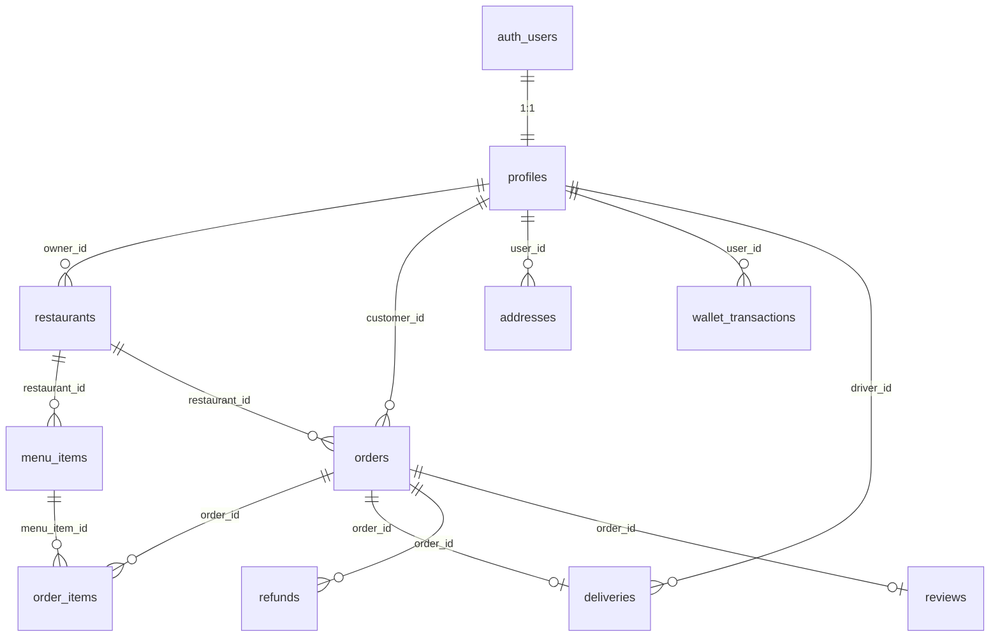

# Deligro — Database Reference

Quick reference for the **Supabase (Postgres)** schema used by the Next.js app.  
Source of truth: [`supabase/migrations/`](../supabase/migrations/) (`0001` → `0007`).

---

## Connection

| Env variable | Purpose |
|--------------|---------|
| `NEXT_PUBLIC_SUPABASE_URL` | Project URL |
| `NEXT_PUBLIC_SUPABASE_PUBLISHABLE_KEY` or `NEXT_PUBLIC_SUPABASE_ANON_KEY` | Browser + RLS-enforced server reads |
| `SUPABASE_SECRET_KEY` or `SUPABASE_SERVICE_ROLE_KEY` | Server-only scripts (bypasses RLS) |

- **Dashboard:** Supabase → your project → Table Editor / SQL Editor  
- **Live counts in app:** `/build`  
- **Never commit** `.env.local`

---

## Enums

| Enum | Values | Used in |
|------|--------|---------|
| `user_role` | `customer`, `restaurant`, `driver`, `admin` | `profiles.role` |
| `order_status` | `placed`, `kitchen`, `ready`, `on_the_way`, `delivered`, `cancelled` | `orders.status` |
| `delivery_status` | `unassigned`, `assigned`, `picked_up`, `delivered`, `cancelled` | `deliveries.status` |
| `refund_status` | `pending`, `approved`, `denied` | `refunds.status` |

### Order status flow (vendor / driver / customer)

```
placed → kitchen → ready → on_the_way → delivered
   ↘ cancelled (vendor or admin)
```

| Legacy PHP status | Supabase `order_status` |
|-------------------|-------------------------|
| ORDER PLACED | `placed` |
| ORDER PROCESSED | `kitchen` |
| ORDER PICKED UP | `on_the_way` |
| ORDER DELIVERED | `delivered` |
| ORDER CANCELED | `cancelled` |

---

## Entity relationship (overview)



---

## Tables

### `auth.users` (Supabase Auth — not in `public`)

Managed by Supabase Auth. Each row gets a matching `profiles` row via trigger `on_auth_user_created`.

| Field (common) | Notes |
|----------------|-------|
| `id` | UUID — same as `profiles.id` |
| `email` | Login email |
| `phone` | Optional; used for OTP login |

---

### `profiles`

One row per authenticated user. **`role` is the authorization source of truth.**

| Column | Type | Default | Notes |
|--------|------|---------|-------|
| `id` | `uuid` PK | — | FK → `auth.users(id)` ON DELETE CASCADE |
| `role` | `user_role` | `customer` | Only admin/service-role can change (trigger `lock_role`) |
| `full_name` | `text` | null | |
| `phone` | `text` | null | Unique when set (partial index) |
| `wallet_balance` | `numeric(10,2)` | `0` | Added in `0006` |
| `onesignal_id` | `text` | null | OneSignal player id for push (`0007`) |
| `created_at` | `timestamptz` | `now()` | |

**RLS:** User reads/updates own row; admin reads all.

**App roles → routes**

| `role` | Portal |
|--------|--------|
| `customer` | `/`, `/checkout`, `/orders` |
| `restaurant` | `/vendor`, `/vendor/menu`, `/vendor/earnings` |
| `driver` | `/driver` |
| `admin` | `/admin` |

---

### `restaurants`

A shop / restaurant listing. Vendor account = `profiles` where `role = 'restaurant'` and `restaurants.owner_id = profiles.id`.

| Column | Type | Default | Notes |
|--------|------|---------|-------|
| `id` | `uuid` PK | `gen_random_uuid()` | |
| `owner_id` | `uuid` | — | FK → `profiles(id)` |
| `slug` | `text` UNIQUE | — | URL: `/restaurant/[slug]` |
| `name` | `text` | — | Display name |
| `tagline` | `text` | null | |
| `is_open` | `boolean` | `true` | Vendor toggle (`/vendor` header) |
| `approved` | `boolean` | `false` | Must be true for customer browse (unless owner) |
| `image_url` | `text` | null | Cover image (`0002`) |
| `accent_tint` | `text` | null | CSS gradient fallback |
| `cuisines` | `text[]` | `{}` | e.g. `{"Fast Food","North Indian"}` |
| `rating` | `numeric(2,1)` | `4.5` | |
| `rating_count` | `integer` | `0` | |
| `eta_min` | `integer` | null | Minutes |
| `eta_max` | `integer` | null | Minutes |
| `price_tier` | `smallint` | `2` | 1 = ₹, 2 = ₹₹, 3 = ₹₹₹ |
| `cost_for_two` | `integer` | null | Whole rupees |
| `distance_km` | `numeric(4,1)` | null | |
| `offer` | `text` | null | Promo line on card |
| `promoted` | `boolean` | `false` | Home feed boost |
| `created_at` | `timestamptz` | `now()` | |

**Indexes:** `owner_id`

**Legacy PHP mapping:** `shop` table → `restaurants`  
**Legacy slug pattern:** `shop-name-{legacy_shop_id}` e.g. `burger-republic`, `chhitiz-swad-restaurant-126`

**RLS:** Customers read `approved = true`; owners read/manage own rows; admin all.

**DAL:** [`src/lib/data-access/restaurants.ts`](../src/lib/data-access/restaurants.ts), [`vendor-restaurant.ts`](../src/lib/data-access/vendor-restaurant.ts)

---

### `menu_items`

| Column | Type | Default | Notes |
|--------|------|---------|-------|
| `id` | `uuid` PK | `gen_random_uuid()` | |
| `restaurant_id` | `uuid` | — | FK → `restaurants(id)` |
| `name` | `text` | — | |
| `description` | `text` | null | |
| `price` | `integer` | — | **Whole rupees** (₹), ≥ 0 |
| `veg` | `boolean` | `true` | |
| `available` | `boolean` | `true` | `false` = sold out on customer UI |
| `external_id` | `text` | null | Legacy import id e.g. `legacy-260` |
| `category` | `text` | null | e.g. `Burgers`, `Popular` |
| `image_url` | `text` | null | |
| `popular` | `boolean` | `false` | |
| `bestseller` | `boolean` | `false` | |
| `sort_order` | `integer` | `0` | Vendor display order (`0009`) |
| `created_at` | `timestamptz` | `now()` | |

**Unique:** `(restaurant_id, external_id)` where `external_id` is not null

**Storage:** public bucket `menu-images` — object path `{restaurant_id}/{filename}`; owners write via `owns_restaurant()` (`0009`)

**Legacy PHP mapping:** `products` → `menu_items` (`status ON/OFF` → `available`)

**RLS:** Public read for approved restaurants; owner CRUD via `owns_restaurant()`.

**DAL:** [`vendor-menu.ts`](../src/lib/data-access/vendor-menu.ts)

---

### `orders`

| Column | Type | Default | Notes |
|--------|------|---------|-------|
| `id` | `uuid` PK | `gen_random_uuid()` | |
| `customer_id` | `uuid` | — | FK → `profiles(id)` |
| `restaurant_id` | `uuid` | — | FK → `restaurants(id)` |
| `status` | `order_status` | `placed` | See enum flow above |
| `total` | `integer` | `0` | **Server-computed** (items + fees), ≥ 0 |
| `delivery_fee` | `integer` | `0` | Whole rupees (`0002`) |
| `tax_amount` | `integer` | `0` | Whole rupees (`0002`) |
| `address` | `jsonb` | null | See shape below |
| `pickup_otp` | `text` | random 4-digit | Restaurant handover (`0006`) |
| `delivery_otp` | `text` | random 4-digit | Rider handover (`0006`) |
| `discount` | `integer` | `0` | Rupees off the grand total. Written only by `apply_coupon_to_order()` (`0031`) |
| `coupon_code` | `text` | null | Snapshot of the code used; no FK, so deleting a coupon can't rewrite history (`0031`) |
| `channel` | `text` | `'app'` | `app` \| `phone` — how the order was taken (`0029`) |
| `placed_by` | `uuid` | null | FK → `profiles(id)` SET NULL. The operator who took a phone order; null for an app order (`0029`) |
| `created_at` | `timestamptz` | `now()` | |

> This column list is not exhaustive past `0012`: `tip` (`0013`),
> `external_id` (`0015`), `payment_method` / `payment_status` (`0025`) and
> `accepted_at` / `ready_at` / `cancelled_at` (`0026`) are also on this table.
> Read the migrations for the full shape.
>
> `0061` adds `preparing_at` (`timestamptz`, null while merely accepted; stamped
> only by `start_preparing(order_id)`, which checks the caller owns the shop and
> the order is `kitchen`) and `prep_minutes` (`smallint` 1–180, the prep time
> promised on accept; a kitchen may change it only while `placed`/`kitchen`).
> The Partner app reads `kitchen` + `preparing_at` null as **Accepted** and
> `kitchen` + `preparing_at` set as **Preparing**.

### Shop hours, stock, variants and add-ons (`0062`)

- **Is the shop open?** `restaurant_status_now(restaurant_id, at default now())` →
  `open` | `closed` (owner switched it off) | `temporarily_closed` (`closed_until`
  ahead) | `holiday` (`store_holidays` covers today) | `weekly_off` | `outside_hours`
  (`opening_time`/`closing_time`; closing before opening means past midnight). IST.
  `restaurant_open_statuses(ids uuid[])` answers many at once for storefronts. Order
  placement refuses a line unless the status is `open`.
- **`store_holidays`** — `restaurant_id`, `starts_on`, `ends_on` (inclusive dates), `note`.
  Readable like the menu; owner/admin write.
- **`menu_items`** gains `stock_qty` (null = untracked), `low_stock_at`,
  `sold_out_by_stock`, `available_days` (smallint[] 0 = Sunday; null = every day),
  `available_from` / `available_to` (time; reversed = past midnight). Stock goes down
  when an order line is inserted and back on cancellation (SECURITY DEFINER triggers);
  at 0 the dish turns sold out, and restocking reverses only that.
- **`menu_item_variants`** (`menu_item_id`, `name`, `price` absolute, `available`,
  `sort_order`), **`menu_item_addon_groups`** (`menu_item_id`, `name`, `min_select`,
  `max_select`), **`menu_item_addons`** (`group_id`, `name`, `price`, `available`).
  Readable like the menu; the dish's owner writes.
- **`order_items.options`** — the client inserts `{"variantId", "addonIds": []}`; the
  guard replaces it with a snapshot `{"variant": {id,name,price}|null, "addons":
  [{id,name,price,group}]}` and sets `price` = variant price (or the dish's effective
  price) + add-ons, and `name` = "Dish (Variant)". A dish with any available variant
  requires one.

### `order_status_events` (`0061`)

One row per status change (`kind = 'status'`, written by the
`log_order_status_event` trigger on insert and on every `status` change) and per
Preparing step (`kind = 'preparing'`, written by `start_preparing`).

| Column | Type | Notes |
|--------|------|-------|
| `id` | `bigint` identity PK | |
| `order_id` | `uuid` | FK → `orders(id)` cascade |
| `restaurant_id` | `uuid` | Copied from the order, for the read policy |
| `kind` | `text` | `status` \| `preparing` |
| `from_status` / `to_status` | `order_status` | `from_status` null for the order being placed |
| `actor_id` | `uuid` | `auth.uid()` of whoever made the change; null for service-role writes |
| `reason` | `text` | The cancellation reason when `to_status = 'cancelled'` |
| `created_at` | `timestamptz` | |

**RLS:** shop owner, the order's customer and admins read; nobody writes
through the API (insert/update/delete revoked from `anon`/`authenticated`).

**`address` JSON shape**

`line` is the full findable address, not a summary: checkout concatenates the
saved street line with the apartment, entry code, floor, building name and
courier note. It is what the rider's board prints and what `mapsDirectionsUrl`
geocodes when the pin is absent. `lat`/`lng` are the delivery pin — optional
(an address saved before the map picker has none), and what the 500 m arrival
notification measures against.

```json
{
  "label": "Home",
  "line": "402, Ashirwad Residency, Koramangala 5th Block, Bengaluru, Gate 2",
  "lat": 21.7157,
  "lng": 81.5335
}
```

Optional `lat` / `lng` may be added from map picker.

**Indexes:** `customer_id`, `restaurant_id`

**RLS:** Customer own orders; restaurant own `restaurant_id`; driver assigned active delivery; manager read + advance `status` (`0023`); admin all.

**INSERT** is `customer_id = auth.uid()` plus a role in (`customer`,
`admin`) — admin joined as of `0040` so the owner's own account, which is an
admin, can shop through the customer app. It inserts as *itself*; posting an
order in another person's name is still the phone-order path below. Because
admin reads every row, customer-facing screens ask `listMyOrders()`
(`customer_id = me`) rather than leaning on RLS to scope the list.

**Column guard:** `guard_order_update()` — anyone who is not admin or the
service role may move `status` and nothing else. `channel`, `placed_by`,
`discount` and `coupon_code` are on that locked list. It is **SECURITY INVOKER**
as of `0030`, deliberately: as DEFINER it read its own owner as `current_user`
and could not tell a trusted server function from a customer, which is the
whole job. `total` is also pinned at INSERT (`0030`), so it cannot be posted
directly.

**No manager INSERT policy — on purpose.** Phone orders are written by
`placePhoneOrder()` through the service role, which stamps `placed_by`. See
SECURITY.md → "Manager".

**DAL:** [`orders.ts`](../src/lib/data-access/orders.ts), [`vendor-orders.ts`](../src/lib/data-access/vendor-orders.ts), [`admin-orders.ts`](../src/lib/data-access/admin-orders.ts), [`manager-orders.ts`](../src/lib/data-access/manager-orders.ts), [`manager-phone-orders.ts`](../src/lib/data-access/manager-phone-orders.ts)

**Vendor board filters:** `status IN ('placed','kitchen','ready')` for active kitchen columns.

---

### `order_items`

Line items snapshotted at order time (price/name frozen even if menu changes).

| Column | Type | Default | Notes |
|--------|------|---------|-------|
| `id` | `uuid` PK | `gen_random_uuid()` | |
| `order_id` | `uuid` | — | FK → `orders(id)` CASCADE |
| `menu_item_id` | `uuid` | null | FK → `menu_items(id)` SET NULL |
| `name` | `text` | — | Snapshot |
| `qty` | `integer` | — | > 0 |
| `price` | `integer` | — | Unit price snapshot, whole rupees |

**Index:** `order_id`

**RLS:** Visibility follows parent order.

---

### `deliveries`

One delivery row per order (1:1, enforced by the UNIQUE on `order_id`).

Since `0042` the row can exist **before** anybody is carrying the order: dispatch
writes an `unassigned` row holding an offer the moment the vendor accepts. Code
that asks "does this order have a rider?" must therefore test `driver_id` (or
`status <> 'unassigned'`), never the mere existence of the row.

| Column | Type | Default | Notes |
|--------|------|---------|-------|
| `id` | `uuid` PK | `gen_random_uuid()` | |
| `order_id` | `uuid` UNIQUE | — | FK → `orders(id)` |
| `driver_id` | `uuid` | null | FK → `profiles(id)`. Null until a rider **accepts** |
| `status` | `delivery_status` | `unassigned` | |
| `assigned_at` | `timestamptz` | null | |
| `picked_up_at` | `timestamptz` | null | Start of the road leg (`0008`) |
| `delivered_at` | `timestamptz` | null | |
| `driver_lat` | `double precision` | null | Last reported fix (`0008`) |
| `driver_lng` | `double precision` | null | (`0008`) |
| `driver_location_at` | `timestamptz` | null | When that fix arrived (`0008`) |
| `driver_location_source` | `text` | null | `gps` \| `none`. Null/`none` = the customer's map is showing an interpolation and must say so (`0026`) |
| `offered_driver_id` | `uuid` | null | FK → `profiles(id)` SET NULL. Who dispatch picked — a first refusal, **not** an assignment (`0042`) |
| `offered_at` | `timestamptz` | null | Start of the exclusivity window (`EXCLUSIVE_OFFER_MS`, `0042`) |
| `arrival_notified_at` | `timestamptz` | null | Once-only latch behind the 500 m "your rider is here" push (`0042`) |
| `cod_collected_amount` | `integer` | null | Rupees the rider confirmed collecting at the door, for a cash-on-delivery order. Written once, when the order is marked delivered (`0047`) |
| `cod_collected_at` | `timestamptz` | null | When the collection was recorded (`0047`) |

**Index:** `driver_id`; partial index on `offered_driver_id` (`0042`)

**RLS:** unchanged by `0042` — `driver_id = auth.uid()`, the owning vendor, or
admin. The offered rider is deliberately *not* admitted: see the header of
`0042_rider_dispatch.sql` for why that clause would leak one rider's live
position to another. The driver board reads this table service-role behind
`requireRole("driver")`.

**DAL:** [`driver-orders.ts`](../src/lib/data-access/driver-orders.ts),
[`rider-dispatch.ts`](../src/lib/dispatch/rider-dispatch.ts)

---

### `refunds`

| Column | Type | Default | Notes |
|--------|------|---------|-------|
| `id` | `uuid` PK | `gen_random_uuid()` | |
| `order_id` | `uuid` | — | FK → `orders(id)` |
| `amount` | `integer` | — | Whole rupees |
| `reason` | `text` | null | |
| `status` | `refund_status` | `pending` | |
| `decided_by` | `uuid` | null | FK → `profiles(id)` admin |
| `created_at` | `timestamptz` | `now()` | |

**RLS:** Customer request + read own; admin approve/deny. Since `0061` the shop
owner also reads refunds on their own orders ("refunds — vendor read"), which
`vendor-earnings.ts` needs.

---

### `settlement_corrections`

A debit against a vendor's future settlement, created when a refund is
approved for an order whose payout was already paid out. Closes the gap the
codebase's own comments used to name directly: `flagSettlementForRefund()`
said "there is no automatic clawback", and `voidSettlement()` still refuses to
reverse a paid batch with "record a correction instead" (`0048`).

| Column | Type | Default | Notes |
|--------|------|---------|-------|
| `id` | `uuid` PK | `gen_random_uuid()` | |
| `restaurant_id` | `uuid` | — | FK → `restaurants(id)` |
| `order_id` | `uuid` | — | FK → `orders(id)` |
| `refund_id` | `uuid` | null | FK → `refunds(id)` SET NULL |
| `original_settlement_id` | `uuid` | — | FK → `vendor_settlements(id)`. The settlement that paid the vendor for this order in the first place |
| `applied_settlement_id` | `uuid` | null | FK → `vendor_settlements(id)` SET NULL. The settlement that actually recovered it, once one exists |
| `amount` | `integer` | — | Whole rupees to recover, > 0. Computed from the drop in the order's settlement `contribution` once the refund is included, via the same `lineFor()` arithmetic every other settlement figure uses, never invented |
| `reason` | `text` | null | |
| `status` | `correction_status` | `outstanding` | `outstanding` \| `applied` \| `voided` |
| `created_by` | `uuid` | — | FK → `profiles(id)`, the admin who approved the triggering refund |
| `created_at` | `timestamptz` | `now()` | |
| `applied_at` | `timestamptz` | null | |

A draft (not yet paid) settlement never needs a row here: voiding and
rebuilding it prices a late-landing refund correctly through the normal
per-line arithmetic, since the order simply re-enters the next preview. This
table exists only for money that has already left the building — a refund
approved after a **paid** settlement.

**Applied automatically:** every outstanding correction for a vendor is netted
into `net_payable` the next time a settlement (draft or instant) is written
for them, and marked `applied` with a trace to that settlement
(`writeSettlement()` in `admin-settlements.ts`). Voiding a settlement that had
absorbed a correction reverts it to `outstanding`.

**RLS:** Admin read only — a manager has no role in vendor settlements
anywhere else in this schema (`0023`), so this table does not extend that
grant. No insert, update or delete policy for any authenticated role: every
write goes through the service role, reached only behind
`requireRole("admin")`, the same shape as `vendor_settlements` itself.

**DAL:** [`admin-settlements.ts`](../src/lib/data-access/admin-settlements.ts) (`createSettlementCorrection`, `outstandingCorrectionsFor`), consumed from [`refunds.ts`](../src/lib/data-access/refunds.ts)

---

### `addresses`

Saved customer delivery addresses.

| Column | Type | Default | Notes |
|--------|------|---------|-------|
| `id` | `uuid` PK | `gen_random_uuid()` | |
| `user_id` | `uuid` | — | FK → `profiles(id)` |
| `label` | `text` | `'Home'` | e.g. Home, Work |
| `line` | `text` | — | Full address string |
| `lat` | `double precision` | null | |
| `lng` | `double precision` | null | |
| `is_default` | `boolean` | `false` | Only one default per user (trigger) |
| `created_at` | `timestamptz` | `now()` | |

**API:** `GET/PATCH/DELETE /api/addresses`, `POST /api/addresses`

---

### `reviews`

| Column | Type | Default | Notes |
|--------|------|---------|-------|
| `id` | `uuid` PK | `gen_random_uuid()` | |
| `order_id` | `uuid` UNIQUE | — | One review per order |
| `user_id` | `uuid` | — | FK → `profiles(id)` |
| `restaurant_id` | `uuid` | — | FK → `restaurants(id)` |
| `rating` | `integer` | — | 1–5 |
| `comment` | `text` | null | |
| `created_at` | `timestamptz` | `now()` | |

**RLS:** Public read; customer insert only on own **delivered** order.

**API:** `POST /api/reviews`

---

### `wallet_transactions`

| Column | Type | Default | Notes |
|--------|------|---------|-------|
| `id` | `uuid` PK | `gen_random_uuid()` | |
| `user_id` | `uuid` | — | FK → `profiles(id)` |
| `amount` | `numeric(10,2)` | — | Positive = credit, negative = debit |
| `reason` | `text` | — | |
| `order_id` | `uuid` | null | FK → `orders(id)` |
| `created_at` | `timestamptz` | `now()` | |

**RLS:** User read own; writes are **service-role only** (client cannot credit self).

---

### `cod_handovers`

Digital record of one leg of the cash-on-delivery handover chain: Customer to
rider, rider to manager, manager to owner. The cash itself can move offline;
this table is what makes that movement auditable, per the confirmed rule that
offline execution must never mean an untracked transaction (`0047`).

| Column | Type | Default | Notes |
|--------|------|---------|-------|
| `id` | `uuid` PK | `gen_random_uuid()` | |
| `leg` | `cash_handover_leg` | — | `rider_to_manager` \| `manager_to_owner` |
| `from_user` | `uuid` | null | FK → `profiles(id)` SET NULL |
| `to_user` | `uuid` | null | FK → `profiles(id)` SET NULL |
| `amount` | `integer` | — | Whole rupees, >= 0 |
| `handover_date` | `date` | `current_date` | Set from IST at write time by the app, not left to the server's own time zone |
| `note` | `text` | null | |
| `recorded_by` | `uuid` | — | FK → `profiles(id)`. Who entered the row, not always `from_user` or `to_user` |
| `created_at` | `timestamptz` | `now()` | |

Not tied to individual orders: a rider hands over a shift's cash in one
amount, not order by order. Reconciling a handover total against
`deliveries.cod_collected_amount` for the same period is shown side by side on
`/admin/cash-ledger`, but is not enforced.

**RLS:** Admin and manager read all rows. No insert, update or delete policy
for any authenticated role: every write goes through the service role from
[`cod-handovers.ts`](../src/lib/data-access/cod-handovers.ts), behind
`requireRole(["manager", "admin"])`, the same shape as `vendor_settlements`
(`0028`). Never updated after creation; a correction is a new row.

**DAL:** [`cod-handovers.ts`](../src/lib/data-access/cod-handovers.ts)

**UI:** `/manager/cash` (record), `/admin/cash-ledger` (owner's view)

---

### `operational_expenses`

A Deligro cost recorded here, whatever the underlying payment channel. Not an
accounts-payable system: no invoices, no approval workflow, no payment
execution. Rider salary, EV bike maintenance and charging, and other small
operational spend can be paid however is practical for a single tier-3 city;
this table is only the digital record that the cost happened (`0047`).

| Column | Type | Default | Notes |
|--------|------|---------|-------|
| `id` | `uuid` PK | `gen_random_uuid()` | |
| `category` | `expense_category` | — | `rider_salary` \| `ev_bike_maintenance` \| `ev_bike_charging` \| `rider_other` \| `small_expense` \| `other` |
| `amount` | `integer` | — | Whole rupees, >= 0 |
| `driver_id` | `uuid` | null | FK → `profiles(id)` SET NULL. Named to match `deliveries.driver_id`; the product calls this role "rider" everywhere above the schema. Set only when the expense is tied to one rider |
| `payment_method` | `expense_payment_method` | `offline_cash` | `offline_cash` \| `offline_bank` \| `upi` \| `other` |
| `expense_date` | `date` | `current_date` | Set from IST at write time by the app |
| `note` | `text` | null | |
| `recorded_by` | `uuid` | — | FK → `profiles(id)` |
| `created_at` | `timestamptz` | `now()` | |

Every amount here classifies as a **Deligro cost**, never revenue. EV bike
allocation (which bike belongs to which rider) is deliberately not tracked
here; it stays an offline register by design. Only the rupee amount, when one
is financially material, gets a record.

**RLS:** Same shape as `cod_handovers`: admin and manager read all rows,
service-role-only writes behind `requireRole(["manager", "admin"])`.

**DAL:** [`operational-expenses.ts`](../src/lib/data-access/operational-expenses.ts)

**UI:** `/manager/cash` (record), `/admin/cash-ledger` (owner's view)

---

### `coupons`

| Column | Type | Default | Notes |
|--------|------|---------|-------|
| `code` | `text` PK | — | e.g. `WELCOME50` |
| `kind` | `text` | — | `percent` or `flat` |
| `value` | `numeric(10,2)` | — | % or flat ₹ amount |
| `min_order` | `numeric(10,2)` | `0` | Minimum cart |
| `max_discount` | `numeric(10,2)` | null | Cap for percent coupons |
| `active` | `boolean` | `true` | |
| `expires_at` | `timestamptz` | null | |
| `created_at` | `timestamptz` | `now()` | |

**Seed coupons:** `WELCOME50`, `FLAT30` (in migration `0006`)

**API:** `POST /api/coupons/validate`

---

### `otp_codes`

Server-only OTP storage for phone login. **No RLS policies** — only service-role can access.

| Column | Type | Default | Notes |
|--------|------|---------|-------|
| `id` | `uuid` PK | `gen_random_uuid()` | |
| `phone` | `text` | — | E.164 e.g. `+919876543210` |
| `code_hash` | `text` | — | `sha256(code + phone + pepper)` |
| `attempts` | `integer` | `0` | Lock after too many wrong tries |
| `consumed` | `boolean` | `false` | |
| `expires_at` | `timestamptz` | — | |
| `created_at` | `timestamptz` | `now()` | |

**API:** `POST /api/auth/otp/request`, `POST /api/auth/otp/verify`

---

## Helper functions (Postgres)

| Function | Purpose |
|----------|---------|
| `owns_restaurant(rid uuid)` | True if `auth.uid()` owns the restaurant |
| `is_admin()` | True if current profile role is `admin` |
| `is_active_driver_for(oid uuid)` | Driver can see order while delivery active |
| `recompute_order_total(oid uuid)` | `total = sum(items) + delivery_fee + tax_amount` |
| `current_role()` | Returns `profiles.role` for `auth.uid()` |

---

## Row Level Security (summary)

| Table | Customer | Restaurant | Driver | Admin |
|-------|----------|------------|--------|-------|
| `profiles` | own | own | own | all |
| `restaurants` | read approved | own CRUD | — | all |
| `menu_items` | read approved menus | own CRUD | — | all |
| `orders` | own insert + read | own restaurant | assigned active | all (+ own insert) |
| `order_items` | via order | via order | via order | via order |
| `deliveries` | — | read own restaurant | own assignment | all |
| `refunds` | request own | read own orders' (`0061`) | — | decide |
| `vendor_settlements` (+ `_orders`) | — | read own, non-draft (`0061`) | — | read; service-role write |
| `settlement_corrections` | — | read own (`0061`) | — | read; service-role write |
| `order_status_events` | read own orders' | read own restaurant | — | read; trigger-only write |
| `addresses` | own CRUD | — | — | — |
| `reviews` | insert delivered | read | read | read |
| `coupons` | read active | read active | read active | service-role manage |
| `wallet_transactions` | read own | read own | read own | service-role write |
| `otp_codes` | **none** (service only) | | | |

---

## Legacy PHP → Supabase mapping

| Legacy MySQL (`deligro-php`) | Supabase table | Notes |
|------------------------------|----------------|-------|
| `shop` | `restaurants` | `status ON/OFF` → `is_open` |
| `products` | `menu_items` | `status ON/OFF` → `available` |
| `category` | `menu_items.category` | Category name as text |
| `orders` | `orders` | **Not fully imported yet** — only new app orders |
| `user` | `profiles` + `auth.users` | Customers imported via `db:import-legacy-customers` |
| `shop.email` / `shop.phone` | vendor `auth.users` | `db:import-legacy-owners` |

---

## Useful scripts

```bash
npm run db:seed-users          # Demo vendor/driver/admin accounts
npm run db:seed                # Seed catalog from src/lib/data.ts (6 demo restaurants)
npm run db:import-legacy       # Import legacy shops + menu from JSON export
npm run db:import-legacy-owners # Link each shop to a vendor auth account
npm run db:import-legacy-customers
```

**Demo vendor login:** `vendor@deligro.demo` / `DeligroDemo1!` (owns 6 seed restaurants — use header dropdown on `/vendor`)

---

## Common SQL snippets

**Count everything**

```sql
select
  (select count(*) from profiles) as profiles,
  (select count(*) from restaurants) as restaurants,
  (select count(*) from menu_items) as menu_items,
  (select count(*) from orders) as orders;
```

**Orders for one restaurant**

```sql
select o.id, o.status, o.total, o.created_at
from orders o
join restaurants r on r.id = o.restaurant_id
where r.slug = 'burger-republic'
order by o.created_at desc;
```

**Menu for one restaurant**

```sql
select m.name, m.price, m.category, m.available
from menu_items m
join restaurants r on r.id = m.restaurant_id
where r.slug = 'burger-republic'
order by m.category, m.name;
```

**Who owns a restaurant**

```sql
select r.name, r.slug, p.full_name, p.role, u.email
from restaurants r
join profiles p on p.id = r.owner_id
join auth.users u on u.id = p.id
where r.slug = 'burger-republic';
```

---

## App code map

| Feature | Data access file | API route |
|---------|------------------|-----------|
| Customer catalog | `src/lib/data-access/restaurants.ts` | — |
| Place order | `src/lib/data-access/orders.ts` | `POST /api/orders` |
| Manager board + dispatch | `src/lib/data-access/manager-orders.ts` | `src/app/manager/actions.ts` |
| Phone order desk | `src/lib/data-access/manager-phone-orders.ts` | `src/app/manager/new-order/actions.ts` |
| Vendor kitchen board | `src/lib/data-access/vendor-orders.ts` | `PATCH /api/orders/[id]/status` |
| Vendor menu toggle | `src/lib/data-access/vendor-menu.ts` | `PATCH /api/vendor/menu/[id]/availability` |
| Vendor earnings | `src/lib/data-access/vendor-earnings.ts` | — |
| Driver board | `src/lib/data-access/driver-orders.ts` | `src/app/driver/actions.ts` |
| Admin orders | `src/lib/data-access/admin-orders.ts` | — |
| Build page stats | `src/lib/data-access/build-stats.ts` | — |
| Cash handovers (COD) | `src/lib/data-access/cod-handovers.ts` | `src/app/manager/cash/actions.ts` |
| Operational expenses | `src/lib/data-access/operational-expenses.ts` | `src/app/manager/cash/actions.ts` |

---

## Money & types convention

- **All prices in DB are whole rupees** (`integer`) unless noted (`numeric` for wallet/coupons).
- **App UI** uses `formatINR()` from `src/lib/utils/format.ts`.
- **IDs** are UUIDs in Postgres; UI shows short codes via `shortOrderId()`.

---

## Migrations order

| File | What it adds |
|------|----------------|
| `0001_init.sql` | Core tables, enums, RLS, triggers |
| `0002_catalog_display.sql` | Restaurant/menu display fields, order fees |
| `0003_lock_role_service_bypass.sql` | Seed scripts can set roles |
| `0005_phone_otp.sql` | `otp_codes` table |
| `0006_customer_features.sql` | Addresses, OTP on orders, reviews, wallet, coupons |
| `0007_push_onesignal.sql` | `profiles.onesignal_id` |
| `0062_store_inventory_options.sql` | `restaurants.shop_phone` / `closed_until`, `store_holidays`, `restaurant_status_now()` / `restaurant_open_statuses()`, menu stock + schedules, `menu_item_variants` / `_addon_groups` / `_addons`, `order_items.options`, guard enforces hours / stock / schedules and prices options |
| `0061_vendor_app_foundation.sql` | `orders.preparing_at` / `prep_minutes`, `order_status_events`, vendor read access to settlements / corrections / refunds, Partner app release track (`platform_settings.vendor_apk_*`) |

---

*Last generated from migrations in-repo. Re-run `/build` or query Supabase for live row counts.*

---

### `role_feature_flags`

Admin switches for what vendors, managers and riders may use (migration `0052`). **RLS on, no policies; all privileges revoked from `anon`/`authenticated`** — read and written only through server-only `src/lib/features/flags.server.ts`, behind `requireRole`.

| Column | Type | Default | Notes |
|--------|------|---------|-------|
| `id` | `uuid` PK | `gen_random_uuid()` | |
| `role` | `text` | — | `vendor`, `manager` or `driver` |
| `feature` | `text` | — | Key from `src/lib/features/catalog.ts`, e.g. `vendor.promotions` |
| `subject_kind` | `text` | `'role'` | `role` (everyone), `restaurant` (one shop), `profile` (one person) |
| `subject_id` | `uuid` | null | Null for `role`; the shop or profile id otherwise (no FK — cleaned up by delete triggers) |
| `enabled` | `boolean` | — | |
| `updated_at` | `timestamptz` | `now()` | |
| `updated_by` | `uuid` → `profiles.id` | null | The admin who last set it |

**Precedence:** this shop's / person's row → the role-wide row → **on**. No row means on, so an empty table (or a database without `0052`) changes nothing.

**Enforcement:** hidden in the app via `FeaturesProvider` / `useFeature`, and refused on the server by `vendorFeatureOn` / `staffFeatureOn` / `assertVendorFeature` in `src/lib/features/guards.server.ts`. Admins are never switched off.

**UI:** Admin → Settings → Feature access (`/admin/settings/features`).
