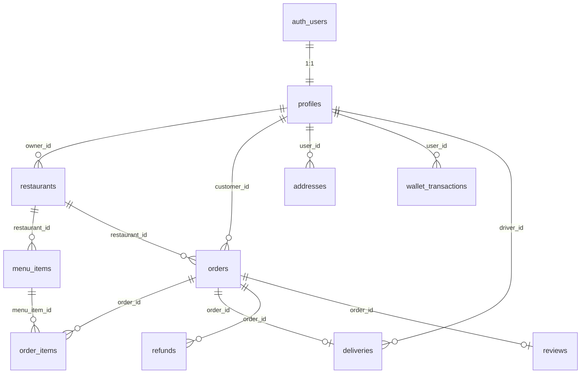

# Deligro — Database Reference

Quick reference for the **Supabase (Postgres)** schema used by the Next.js app.  
Source of truth: [`supabase/migrations/`](../supabase/migrations/) (`0001` → `0007`).

---

## Connection

| Env variable | Purpose |
|--------------|---------|
| `NEXT_PUBLIC_SUPABASE_URL` | Project URL |
| `NEXT_PUBLIC_SUPABASE_PUBLISHABLE_KEY` or `NEXT_PUBLIC_SUPABASE_ANON_KEY` | Browser + RLS-enforced server reads |
| `SUPABASE_SECRET_KEY` or `SUPABASE_SERVICE_ROLE_KEY` | Server-only scripts (bypasses RLS) |

- **Dashboard:** Supabase → your project → Table Editor / SQL Editor  
- **Live counts in app:** `/build`  
- **Never commit** `.env.local`

---

## Enums

| Enum | Values | Used in |
|------|--------|---------|
| `user_role` | `customer`, `restaurant`, `driver`, `admin` | `profiles.role` |
| `order_status` | `placed`, `kitchen`, `ready`, `on_the_way`, `delivered`, `cancelled` | `orders.status` |
| `delivery_status` | `unassigned`, `assigned`, `picked_up`, `delivered`, `cancelled`, `failed` (`0081`) | `deliveries.status` |
| `refund_status` | `pending`, `approved`, `denied` | `refunds.status` |

### Order status flow (vendor / driver / customer)

```
placed → kitchen → ready → on_the_way → delivered
   ↘ cancelled (vendor or admin)
```

| Legacy PHP status | Supabase `order_status` |
|-------------------|-------------------------|
| ORDER PLACED | `placed` |
| ORDER PROCESSED | `kitchen` |
| ORDER PICKED UP | `on_the_way` |
| ORDER DELIVERED | `delivered` |
| ORDER CANCELED | `cancelled` |

---

## Entity relationship (overview)



---

## Tables

### `auth.users` (Supabase Auth — not in `public`)

Managed by Supabase Auth. Each row gets a matching `profiles` row via trigger `on_auth_user_created`.

| Field (common) | Notes |
|----------------|-------|
| `id` | UUID — same as `profiles.id` |
| `email` | Login email |
| `phone` | Optional; used for OTP login |

---

### `profiles`

One row per authenticated user. **`role` is the authorization source of truth.**

| Column | Type | Default | Notes |
|--------|------|---------|-------|
| `id` | `uuid` PK | — | FK → `auth.users(id)` ON DELETE CASCADE |
| `role` | `user_role` | `customer` | Only admin/service-role can change (trigger `lock_role`) |
| `full_name` | `text` | null | |
| `phone` | `text` | null | Unique when set (partial index) |
| `wallet_balance` | `numeric(10,2)` | `0` | Added in `0006` |
| `onesignal_id` | `text` | null | OneSignal player id for push (`0007`) |
| `created_at` | `timestamptz` | `now()` | |

**RLS:** User reads/updates own row; admin reads all.

**App roles → routes**

| `role` | Portal |
|--------|--------|
| `customer` | `/`, `/checkout`, `/orders` |
| `restaurant` | `/vendor`, `/vendor/menu`, `/vendor/earnings` |
| `driver` | `/driver` |
| `admin` | `/admin` |

---

### `restaurants`

A shop / restaurant listing. Vendor account = `profiles` where `role = 'restaurant'` and `restaurants.owner_id = profiles.id`.

| Column | Type | Default | Notes |
|--------|------|---------|-------|
| `id` | `uuid` PK | `gen_random_uuid()` | |
| `owner_id` | `uuid` | — | FK → `profiles(id)` |
| `slug` | `text` UNIQUE | — | URL: `/restaurant/[slug]` |
| `name` | `text` | — | Display name |
| `tagline` | `text` | null | |
| `is_open` | `boolean` | `true` | Vendor toggle (`/vendor` header) |
| `approved` | `boolean` | `false` | Must be true for customer browse (unless owner) |
| `image_url` | `text` | null | Cover image (`0002`) |
| `accent_tint` | `text` | null | CSS gradient fallback |
| `cuisines` | `text[]` | `{}` | e.g. `{"Fast Food","North Indian"}` |
| `rating` | `numeric(2,1)` | `4.5` | |
| `rating_count` | `integer` | `0` | |
| `eta_min` | `integer` | null | Minutes |
| `eta_max` | `integer` | null | Minutes |
| `price_tier` | `smallint` | `2` | 1 = ₹, 2 = ₹₹, 3 = ₹₹₹ |
| `cost_for_two` | `integer` | null | Whole rupees |
| `distance_km` | `numeric(4,1)` | null | |
| `offer` | `text` | null | Promo line on card |
| `promoted` | `boolean` | `false` | Home feed boost |
| `created_at` | `timestamptz` | `now()` | |

**Indexes:** `owner_id`

**Legacy PHP mapping:** `shop` table → `restaurants`  
**Legacy slug pattern:** `shop-name-{legacy_shop_id}` e.g. `burger-republic`, `chhitiz-swad-restaurant-126`

**RLS:** Customers read `approved = true`; owners read/manage own rows; admin all.

**DAL:** [`src/lib/data-access/restaurants.ts`](../src/lib/data-access/restaurants.ts), [`vendor-restaurant.ts`](../src/lib/data-access/vendor-restaurant.ts)

---

### `menu_items`

| Column | Type | Default | Notes |
|--------|------|---------|-------|
| `id` | `uuid` PK | `gen_random_uuid()` | |
| `restaurant_id` | `uuid` | — | FK → `restaurants(id)` |
| `name` | `text` | — | |
| `description` | `text` | null | |
| `price` | `integer` | — | **Whole rupees** (₹), ≥ 0 |
| `veg` | `boolean` | `true` | |
| `available` | `boolean` | `true` | `false` = sold out on customer UI |
| `external_id` | `text` | null | Legacy import id e.g. `legacy-260` |
| `category` | `text` | null | e.g. `Burgers`, `Popular` |
| `image_url` | `text` | null | |
| `popular` | `boolean` | `false` | |
| `bestseller` | `boolean` | `false` | |
| `sort_order` | `integer` | `0` | Vendor display order (`0009`) |
| `created_at` | `timestamptz` | `now()` | |

**Unique:** `(restaurant_id, external_id)` where `external_id` is not null

**Storage:** public bucket `menu-images` — object path `{restaurant_id}/{filename}`; owners write via `owns_restaurant()` (`0009`)

**Legacy PHP mapping:** `products` → `menu_items` (`status ON/OFF` → `available`)

**RLS:** Public read for approved restaurants; owner CRUD via `owns_restaurant()`.

**DAL:** [`vendor-menu.ts`](../src/lib/data-access/vendor-menu.ts)

---

### `orders`

| Column | Type | Default | Notes |
|--------|------|---------|-------|
| `id` | `uuid` PK | `gen_random_uuid()` | |
| `customer_id` | `uuid` | — | FK → `profiles(id)` |
| `restaurant_id` | `uuid` | — | FK → `restaurants(id)` |
| `status` | `order_status` | `placed` | See enum flow above |
| `total` | `integer` | `0` | **Server-computed** (items + fees), ≥ 0 |
| `delivery_fee` | `integer` | `0` | Whole rupees (`0002`) |
| `tax_amount` | `integer` | `0` | Whole rupees (`0002`) |
| `address` | `jsonb` | null | See shape below |
| `pickup_otp` | `text` | random 4-digit | Restaurant handover (`0006`) |
| `delivery_otp` | `text` | random 4-digit | Rider handover (`0006`) |
| `discount` | `integer` | `0` | Rupees off the grand total. Written only by `apply_coupon_to_order()` (`0031`) |
| `coupon_code` | `text` | null | Snapshot of the code used; no FK, so deleting a coupon can't rewrite history (`0031`) |
| `channel` | `text` | `'app'` | `app` \| `phone` — how the order was taken (`0029`) |
| `placed_by` | `uuid` | null | FK → `profiles(id)` SET NULL. The operator who took a phone order; null for an app order (`0029`) |
| `delivery_instructions` | `text` | null | The customer's note to the rider, ≤ 300 chars (CHECK). Granted to `authenticated` by column; locked by `guard_order_update`; written by the service role (`0082`) |
| `created_at` | `timestamptz` | `now()` | |

> This column list is not exhaustive past `0012`: `tip` (`0013`),
> `external_id` (`0015`), `payment_method` / `payment_status` (`0025`) and
> `accepted_at` / `ready_at` / `cancelled_at` (`0026`) are also on this table.
> Read the migrations for the full shape.

**`address` JSON shape**

`line` is the full findable address, not a summary: checkout concatenates the
saved street line with the apartment, entry code, floor, building name and
courier note. It is what the rider's board prints and what `mapsDirectionsUrl`
geocodes when the pin is absent. `lat`/`lng` are the delivery pin — optional
(an address saved before the map picker has none), and what the 500 m arrival
notification measures against.

```json
{
  "label": "Home",
  "line": "402, Ashirwad Residency, Koramangala 5th Block, Bengaluru, Gate 2",
  "lat": 21.7157,
  "lng": 81.5335
}
```

Optional `lat` / `lng` may be added from map picker.

**Indexes:** `customer_id`, `restaurant_id`

**RLS:** Customer own orders; restaurant own `restaurant_id`; driver assigned active delivery; manager read + advance `status` (`0023`); admin all.

**INSERT** is `customer_id = auth.uid()` plus a role in (`customer`,
`admin`) — admin joined as of `0040` so the owner's own account, which is an
admin, can shop through the customer app. It inserts as *itself*; posting an
order in another person's name is still the phone-order path below. Because
admin reads every row, customer-facing screens ask `listMyOrders()`
(`customer_id = me`) rather than leaning on RLS to scope the list.

**Column guard:** `guard_order_update()` — anyone who is not admin or the
service role may move `status` and nothing else. `channel`, `placed_by`,
`discount`, `coupon_code` and (`0082`) `delivery_instructions` are on that locked list. It is **SECURITY INVOKER**
as of `0030`, deliberately: as DEFINER it read its own owner as `current_user`
and could not tell a trusted server function from a customer, which is the
whole job. `total` is also pinned at INSERT (`0030`), so it cannot be posted
directly.

**No manager INSERT policy — on purpose.** Phone orders are written by
`placePhoneOrder()` through the service role, which stamps `placed_by`. See
SECURITY.md → "Manager".

**DAL:** [`orders.ts`](../src/lib/data-access/orders.ts), [`vendor-orders.ts`](../src/lib/data-access/vendor-orders.ts), [`admin-orders.ts`](../src/lib/data-access/admin-orders.ts), [`manager-orders.ts`](../src/lib/data-access/manager-orders.ts), [`manager-phone-orders.ts`](../src/lib/data-access/manager-phone-orders.ts)

**Vendor board filters:** `status IN ('placed','kitchen','ready')` for active kitchen columns.

---

### `order_items`

Line items snapshotted at order time (price/name frozen even if menu changes).

| Column | Type | Default | Notes |
|--------|------|---------|-------|
| `id` | `uuid` PK | `gen_random_uuid()` | |
| `order_id` | `uuid` | — | FK → `orders(id)` CASCADE |
| `menu_item_id` | `uuid` | null | FK → `menu_items(id)` SET NULL |
| `name` | `text` | — | Snapshot |
| `qty` | `integer` | — | > 0 |
| `price` | `integer` | — | Unit price snapshot, whole rupees |

**Index:** `order_id`

**RLS:** Visibility follows parent order.

---

### `deliveries`

One delivery row per order (1:1, enforced by the UNIQUE on `order_id`).

Since `0042` the row can exist **before** anybody is carrying the order: dispatch
writes an `unassigned` row holding an offer the moment the vendor accepts. Code
that asks "does this order have a rider?" must therefore test `driver_id` (or
`status <> 'unassigned'`), never the mere existence of the row.

| Column | Type | Default | Notes |
|--------|------|---------|-------|
| `id` | `uuid` PK | `gen_random_uuid()` | |
| `order_id` | `uuid` UNIQUE | — | FK → `orders(id)` |
| `driver_id` | `uuid` | null | FK → `profiles(id)`. Null until a rider **accepts** |
| `status` | `delivery_status` | `unassigned` | |
| `assigned_at` | `timestamptz` | null | |
| `picked_up_at` | `timestamptz` | null | Start of the road leg (`0008`) |
| `delivered_at` | `timestamptz` | null | |
| `driver_lat` | `double precision` | null | Last reported fix (`0008`) |
| `driver_lng` | `double precision` | null | (`0008`) |
| `driver_location_at` | `timestamptz` | null | When that fix arrived (`0008`) |
| `driver_location_source` | `text` | null | `gps` \| `none`. Null/`none` = the customer's map is showing an interpolation and must say so (`0026`) |
| `offered_driver_id` | `uuid` | null | FK → `profiles(id)` SET NULL. Who dispatch picked — a first refusal, **not** an assignment (`0042`) |
| `offered_at` | `timestamptz` | null | Start of the exclusivity window (`EXCLUSIVE_OFFER_MS`, `0042`) |
| `arrival_notified_at` | `timestamptz` | null | Once-only latch behind the 500 m "your rider is here" push (`0042`) |
| `cod_collected_amount` | `integer` | null | Rupees the rider confirmed collecting at the door, for a cash-on-delivery order. Written once, when the order is marked delivered (`0047`) |
| `cod_collected_at` | `timestamptz` | null | When the collection was recorded (`0047`) |
| `arrived_pickup_at` | `timestamptz` | null | Rider reached the shop. Set once (`0081`) |
| `departed_pickup_at` | `timestamptz` | null | Rider left the shop with the order. Set once (`0081`) |
| `arrived_drop_at` | `timestamptz` | null | Rider reached the customer. Set once (`0081`) |
| `failed_at` | `timestamptz` | null | Stamped by the guard on `-> failed` (`0081`) |
| `failure_reason` | `text` | null | Required for `failed` (`0081`) |
| `pickup_method` | `text` | null | `code` \| `qr` \| `vendor` \| `manual` \| `none`: how the pickup was proved (`0081`) |
| `delivery_method` | `text` | null | `code` \| `photo` \| `ops_approved` \| `staff`: how the delivery was proved (`0081`) |
| `distance_km` | `numeric(6,2)` | null | Route distance shop -> customer, >= 0 (`0081`) |
| `last_action_id` | `uuid` | null | Rider app's per-tap id; copied to `delivery_events.client_action_id` so a replayed tap fails with 23505 (`0081`) |
| `correction_reason` | `text` | null | Staff paths only. Changing it makes the update a **correction** (`0081`) |
| `pod_photo_path` | `text` | null | Proof-of-delivery photo: object path in the private `delivery-proofs` bucket, served only via short-lived signed URLs (`0082`) |
| `distance_source` | `text` | null | How `distance_km` was computed: `road` (routing server) \| `estimate` (straight line x 1.3, upgraded to `road` after acceptance when routing answers) (`0082`) |

**Index:** `driver_id`; partial index on `offered_driver_id` (`0042`)

**Triggers (`0081`):**

- `guard_delivery_transition` (BEFORE UPDATE, every role **including
  service_role**). A correction (an update that changes `correction_reason`)
  relaxes rules 1, 4 and 5 only. (1) `-> delivered` needs `picked_up_at`;
  stamps `delivered_at`. (2) `-> picked_up` needs old status `assigned` and a
  `driver_id`; stamps `picked_up_at`. (3) `-> failed` needs a non-blank
  `failure_reason` and old status `assigned`/`picked_up`; stamps `failed_at`.
  (4) `arrived_pickup_at`, `departed_pickup_at`, `arrived_drop_at`,
  `picked_up_at` cannot change once set. (5) nothing leaves `delivered`,
  `failed`, `cancelled`. Violations raise `invalid_delivery_transition`
  (SQLSTATE 23514, the broken rule in DETAIL).
  **`0082` adds** (re-declaring the function; corrections bypass 6–9):
  (6) `-> delivered` also needs old status `picked_up`. (7) `-> failed` needs
  an **approved** `failed_delivery`, `customer_unreachable` or `wrong_address`
  exception for this delivery and its current rider. (8) `delivery_method`
  becoming `ops_approved` needs an approved `complete_without_code`. (9)
  `pickup_method` becoming `manual` needs an approved `manual_pickup`. (10) A
  **release** (`driver_id` non-null → null) must be a correction, must land on
  `unassigned`, must come out of `assigned` (not `picked_up` — the rider has
  the food — nor a terminal status), and clears `assigned_at`, the
  four arrival/pickup/departure stamps and `pickup_method` so the next rider can
  set them; it also clears `offered_driver_id` / `offered_at`. Each release
  carries its own `correction_reason` (`released:<why>:<id>`). (11) Rules 7–9
  count an approval only if it was raised during the current assignment
  (`created_at >= assigned_at`), and a non-correction update that gives the job
  to a rider stamps `assigned_at = now()` so both sides are the database's
  clock. The exception lookup runs as the writer (SECURITY INVOKER) — the
  service role, admins and managers read every exception.
- `guard_delivery_insert` (BEFORE INSERT, every role, `0082`): outside a
  correction (`correction_reason` set), a new delivery is `unassigned`, or
  `assigned` with a `driver_id`, and carries no `picked_up_at`, `delivered_at`,
  `failed_at`, `pickup_method` or `delivery_method`; `assigned_at` is stamped
  `now()` when it has a rider. Raises `invalid_delivery_transition` (23514).
- `log_delivery_event` (AFTER INSERT OR UPDATE, SECURITY DEFINER) writes
  `delivery_events` rows: `offered`, `accepted`, `reassigned`,
  `arrived_pickup`, `picked_up` (+method), `departed`, `arrived_drop`,
  `delivered` (+method), `failed` (+reason), `cancelled`, `corrected` (+reason).
  Since `0082` a reassignment writes `reassigned` (the rider who lost it)
  **and** `accepted` (the rider who took it), and a release writes `released`
  (the rider who lost it, + the correction reason).
- `log_delivery_withdrawn` (AFTER DELETE, when the row was `unassigned` with
  an `offered_driver_id`, SECURITY DEFINER, `0082`) writes `withdrawn` for the
  offered rider, so every `offered` row has an outcome. Nothing is written when
  the order itself is being deleted.
- `mark_delivery_action` (BEFORE UPDATE OF `last_action_id`) tells the logger
  that the update set the id itself, so a replay of the same id is caught while
  a later write that merely leaves the old id on the row is not. The id goes on
  the first event of the update only.
- `record_rider_earning` (AFTER UPDATE, when `status` **becomes**
  `delivered`, SECURITY DEFINER, `0083`) writes the rider's `rider_earnings`
  row from the rate card in force at that moment — unless that rider already
  holds a live (not reversed) earning for the delivery. See `rider_earnings`.
- `reverse_rider_earning` (AFTER UPDATE, when `status` **leaves**
  `delivered` — a staff correction — SECURITY DEFINER, `0083`, ruling P3-R4)
  writes a reversing `rider_adjustments` row for each live earning of the
  delivery.
- `guard_delivered_rider` (BEFORE UPDATE OF `driver_id`, every role,
  corrections included, `0083`, ruling P3-R7): the rider of a `delivered`
  delivery cannot change (`invalid_delivery_transition`, 23514). To move the
  pay, correct the status out of `delivered` (which reverses) and complete it
  with the other rider.
- `guard_delivery_delete` (BEFORE DELETE, SECURITY DEFINER, `0083`, ruling
  P3-R8): a delivery with a rider earning (live or reversed) cannot be deleted
  (`delivery_has_earnings`, 23001) — nor, through the cascade, its order.

The staff path (`recordCodForStaffDelivery`) is a correction
(`correction_reason = 'staff_marked_delivered'`, `delivery_method = 'staff'`).

**RLS:** unchanged by `0042` — `driver_id = auth.uid()`, the owning vendor, or
admin. The offered rider is deliberately *not* admitted: see the header of
`0042_rider_dispatch.sql` for why that clause would leak one rider's live
position to another. The driver board reads this table service-role behind
`requireRole("driver")`.

**DAL:** [`driver-orders.ts`](../src/lib/data-access/driver-orders.ts),
[`rider-dispatch.ts`](../src/lib/dispatch/rider-dispatch.ts)

---

### `refunds`

| Column | Type | Default | Notes |
|--------|------|---------|-------|
| `id` | `uuid` PK | `gen_random_uuid()` | |
| `order_id` | `uuid` | — | FK → `orders(id)` |
| `amount` | `integer` | — | Whole rupees |
| `reason` | `text` | null | |
| `status` | `refund_status` | `pending` | |
| `decided_by` | `uuid` | null | FK → `profiles(id)` admin |
| `created_at` | `timestamptz` | `now()` | |

**RLS:** Customer request + read own; admin approve/deny.

---

### `settlement_corrections`

A debit against a vendor's future settlement, created when a refund is
approved for an order whose payout was already paid out. Closes the gap the
codebase's own comments used to name directly: `flagSettlementForRefund()`
said "there is no automatic clawback", and `voidSettlement()` still refuses to
reverse a paid batch with "record a correction instead" (`0048`).

| Column | Type | Default | Notes |
|--------|------|---------|-------|
| `id` | `uuid` PK | `gen_random_uuid()` | |
| `restaurant_id` | `uuid` | — | FK → `restaurants(id)` |
| `order_id` | `uuid` | — | FK → `orders(id)` |
| `refund_id` | `uuid` | null | FK → `refunds(id)` SET NULL |
| `original_settlement_id` | `uuid` | — | FK → `vendor_settlements(id)`. The settlement that paid the vendor for this order in the first place |
| `applied_settlement_id` | `uuid` | null | FK → `vendor_settlements(id)` SET NULL. The settlement that actually recovered it, once one exists |
| `amount` | `integer` | — | Whole rupees to recover, > 0. Computed from the drop in the order's settlement `contribution` once the refund is included, via the same `lineFor()` arithmetic every other settlement figure uses, never invented |
| `reason` | `text` | null | |
| `status` | `correction_status` | `outstanding` | `outstanding` \| `applied` \| `voided` |
| `created_by` | `uuid` | — | FK → `profiles(id)`, the admin who approved the triggering refund |
| `created_at` | `timestamptz` | `now()` | |
| `applied_at` | `timestamptz` | null | |

A draft (not yet paid) settlement never needs a row here: voiding and
rebuilding it prices a late-landing refund correctly through the normal
per-line arithmetic, since the order simply re-enters the next preview. This
table exists only for money that has already left the building — a refund
approved after a **paid** settlement.

**Applied automatically:** every outstanding correction for a vendor is netted
into `net_payable` the next time a settlement (draft or instant) is written
for them, and marked `applied` with a trace to that settlement
(`writeSettlement()` in `admin-settlements.ts`). Voiding a settlement that had
absorbed a correction reverts it to `outstanding`.

**RLS:** Admin read only — a manager has no role in vendor settlements
anywhere else in this schema (`0023`), so this table does not extend that
grant. No insert, update or delete policy for any authenticated role: every
write goes through the service role, reached only behind
`requireRole("admin")`, the same shape as `vendor_settlements` itself.

**DAL:** [`admin-settlements.ts`](../src/lib/data-access/admin-settlements.ts) (`createSettlementCorrection`, `outstandingCorrectionsFor`), consumed from [`refunds.ts`](../src/lib/data-access/refunds.ts)

---

### `addresses`

Saved customer delivery addresses.

| Column | Type | Default | Notes |
|--------|------|---------|-------|
| `id` | `uuid` PK | `gen_random_uuid()` | |
| `user_id` | `uuid` | — | FK → `profiles(id)` |
| `label` | `text` | `'Home'` | e.g. Home, Work |
| `line` | `text` | — | Full address string |
| `lat` | `double precision` | null | |
| `lng` | `double precision` | null | |
| `is_default` | `boolean` | `false` | Only one default per user (trigger) |
| `created_at` | `timestamptz` | `now()` | |

**API:** `GET/PATCH/DELETE /api/addresses`, `POST /api/addresses`

---

### `reviews`

| Column | Type | Default | Notes |
|--------|------|---------|-------|
| `id` | `uuid` PK | `gen_random_uuid()` | |
| `order_id` | `uuid` UNIQUE | — | One review per order |
| `user_id` | `uuid` | — | FK → `profiles(id)` |
| `restaurant_id` | `uuid` | — | FK → `restaurants(id)` |
| `rating` | `integer` | — | 1–5 |
| `comment` | `text` | null | |
| `created_at` | `timestamptz` | `now()` | |

**RLS:** Public read; customer insert only on own **delivered** order.

**API:** `POST /api/reviews`

---

### `wallet_transactions`

| Column | Type | Default | Notes |
|--------|------|---------|-------|
| `id` | `uuid` PK | `gen_random_uuid()` | |
| `user_id` | `uuid` | — | FK → `profiles(id)` |
| `amount` | `numeric(10,2)` | — | Positive = credit, negative = debit |
| `reason` | `text` | — | |
| `order_id` | `uuid` | null | FK → `orders(id)` |
| `created_at` | `timestamptz` | `now()` | |

**RLS:** User read own; writes are **service-role only** (client cannot credit self).

---

### `cod_handovers`

Digital record of one leg of the cash-on-delivery handover chain: Customer to
rider, rider to manager, manager to owner. The cash itself can move offline;
this table is what makes that movement auditable, per the confirmed rule that
offline execution must never mean an untracked transaction (`0047`).

| Column | Type | Default | Notes |
|--------|------|---------|-------|
| `id` | `uuid` PK | `gen_random_uuid()` | |
| `leg` | `cash_handover_leg` | — | `rider_to_manager` \| `manager_to_owner` |
| `from_user` | `uuid` | null | FK → `profiles(id)` SET NULL |
| `to_user` | `uuid` | null | FK → `profiles(id)` SET NULL |
| `amount` | `integer` | — | Whole rupees, >= 0 |
| `handover_date` | `date` | `current_date` | Set from IST at write time by the app, not left to the server's own time zone |
| `note` | `text` | null | |
| `recorded_by` | `uuid` | — | FK → `profiles(id)`. Who entered the row, not always `from_user` or `to_user` |
| `created_at` | `timestamptz` | `now()` | |

Not tied to individual orders: a rider hands over a shift's cash in one
amount, not order by order. Reconciling a handover total against
`deliveries.cod_collected_amount` for the same period is shown side by side on
`/admin/cash-ledger`, but is not enforced.

**RLS:** Admin and manager read all rows. No insert, update or delete policy
for any authenticated role: every write goes through the service role from
[`cod-handovers.ts`](../src/lib/data-access/cod-handovers.ts), behind
`requireRole(["manager", "admin"])`, the same shape as `vendor_settlements`
(`0028`). Never updated after creation; a correction is a new row.

**DAL:** [`cod-handovers.ts`](../src/lib/data-access/cod-handovers.ts)

**UI:** `/manager/cash` (record), `/admin/cash-ledger` (owner's view)

---

### `operational_expenses`

A Deligro cost recorded here, whatever the underlying payment channel. Not an
accounts-payable system: no invoices, no approval workflow, no payment
execution. Rider salary, EV bike maintenance and charging, and other small
operational spend can be paid however is practical for a single tier-3 city;
this table is only the digital record that the cost happened (`0047`).

| Column | Type | Default | Notes |
|--------|------|---------|-------|
| `id` | `uuid` PK | `gen_random_uuid()` | |
| `category` | `expense_category` | — | `rider_salary` \| `ev_bike_maintenance` \| `ev_bike_charging` \| `rider_other` \| `small_expense` \| `other` |
| `amount` | `integer` | — | Whole rupees, >= 0 |
| `driver_id` | `uuid` | null | FK → `profiles(id)` SET NULL. Named to match `deliveries.driver_id`; the product calls this role "rider" everywhere above the schema. Set only when the expense is tied to one rider |
| `payment_method` | `expense_payment_method` | `offline_cash` | `offline_cash` \| `offline_bank` \| `upi` \| `other` |
| `expense_date` | `date` | `current_date` | Set from IST at write time by the app |
| `note` | `text` | null | |
| `recorded_by` | `uuid` | — | FK → `profiles(id)` |
| `created_at` | `timestamptz` | `now()` | |

Every amount here classifies as a **Deligro cost**, never revenue. EV bike
allocation (which bike belongs to which rider) is deliberately not tracked
here; it stays an offline register by design. Only the rupee amount, when one
is financially material, gets a record.

**RLS:** Same shape as `cod_handovers`: admin and manager read all rows,
service-role-only writes behind `requireRole(["manager", "admin"])`.

**DAL:** [`operational-expenses.ts`](../src/lib/data-access/operational-expenses.ts)

**UI:** `/manager/cash` (record), `/admin/cash-ledger` (owner's view)

---

### `coupons`

| Column | Type | Default | Notes |
|--------|------|---------|-------|
| `code` | `text` PK | — | e.g. `WELCOME50` |
| `kind` | `text` | — | `percent` or `flat` |
| `value` | `numeric(10,2)` | — | % or flat ₹ amount |
| `min_order` | `numeric(10,2)` | `0` | Minimum cart |
| `max_discount` | `numeric(10,2)` | null | Cap for percent coupons |
| `active` | `boolean` | `true` | |
| `expires_at` | `timestamptz` | null | |
| `created_at` | `timestamptz` | `now()` | |

**Seed coupons:** `WELCOME50`, `FLAT30` (in migration `0006`)

**API:** `POST /api/coupons/validate`

---

### `otp_codes`

Server-only OTP storage for phone login. **No RLS policies** — only service-role can access.

| Column | Type | Default | Notes |
|--------|------|---------|-------|
| `id` | `uuid` PK | `gen_random_uuid()` | |
| `phone` | `text` | — | E.164 e.g. `+919876543210` |
| `code_hash` | `text` | — | `sha256(code + phone + pepper)` |
| `attempts` | `integer` | `0` | Lock after too many wrong tries |
| `consumed` | `boolean` | `false` | |
| `expires_at` | `timestamptz` | — | |
| `created_at` | `timestamptz` | `now()` | |

**API:** `POST /api/auth/otp/request`, `POST /api/auth/otp/verify`

---

### `rider_status`

One row per rider who has ever gone online (`0081`). No row = offline.

| Column | Type | Default | Notes |
|--------|------|---------|-------|
| `driver_id` | `uuid` PK | — | FK → `profiles(id)` CASCADE |
| `is_online` | `boolean` | `false` | |
| `break_until` | `timestamptz` | null | On a break until then; dispatch skips the rider, the shift continues |
| `online_since` | `timestamptz` | null | |
| `last_lat` / `last_lng` | `double precision` | null | Last fix |
| `last_fix_at` | `timestamptz` | null | A stale fix takes the rider out of dispatch |
| `updated_at` | `timestamptz` | `now()` | |

### `rider_shifts`

One row per online session, for hours and attendance (`0081`).

| Column | Type | Default | Notes |
|--------|------|---------|-------|
| `id` | `bigint` identity PK | | |
| `driver_id` | `uuid` | — | FK → `profiles(id)` CASCADE |
| `started_at` | `timestamptz` | — | |
| `ended_at` | `timestamptz` | null | >= `started_at` |
| `ended_by` | `text` | null | `rider` \| `logout` \| `ops` \| `presence` |

**Index:** `(driver_id, started_at desc)`; unique partial `(driver_id) where ended_at is null`, so one open shift per rider.

### `rider_profiles`

Rider-only profile data (`0081`); later phases add columns.

| Column | Type | Default | Notes |
|--------|------|---------|-------|
| `driver_id` | `uuid` PK | — | FK → `profiles(id)` CASCADE |
| `rider_code` | `text` UNIQUE | `next_rider_code()` | `DR-0001`, `DR-0002`, … from `rider_code_seq`, in registration order; never reused, not truncated past 9999 |
| `created_at` / `updated_at` | `timestamptz` | `now()` | |
| `address_line`, `city` | `text` | null | `0086`. Stored as typed (any script) |
| `pincode` | `text` | null | CHECK `^\d{6}$` (`0086`) |
| `vehicle_type` | `text` | null | `ev_bike` \| `bike` \| `scooter` \| `bicycle` \| `other` (`0086`) |
| `vehicle_owner` | `text` | `deligro` | `deligro` \| `rider`; `rider` makes RC, insurance and PUC required (`0086`) |
| `vehicle_registration` | `text` | null | `0086` |
| `licence_number` | `text` | null | In full. **Not granted** to `anon`/`authenticated` (`0086`) |
| `licence_expires_on` | `date` | null | `0086` |
| `emergency_name`, `emergency_relation` | `text` | null | `0086` |
| `emergency_phone` | `text` | null | CHECK `^\+?\d{10,13}$` (`0086`) |
| `verification_status` | `text` | `unverified` | `unverified` \| `pending` \| `verified` \| `rejected` (`0086`) |
| `verified_at`, `verified_by` | | null | Set when an admin verifies (`0086`). `verified_at` set = "ever verified": name, licence and vehicle then change only through an approved request |
| `verification_note` | `text` ≤ 300 | null | The admin's note on the last verification decision (`0086`; not in 0150). Not granted to clients |
| `notification_prefs` | `jsonb` | `{}` | `0086`; read in the Settings phase |
| `nav_app`, `language` | `text` | null, `en` | `0086` |

Trigger `ensure_rider_profile` on `profiles` (AFTER INSERT OR UPDATE OF `role`,
when `role = 'driver'`, SECURITY DEFINER) creates the row; existing drivers were
backfilled in `profiles.created_at` order.

Since `0086` SELECT on `rider_profiles` is granted **by column**, every column
except `licence_number` (AGENTS.md rule 1): a rider reads their own row, and
managers every row (0081's policy), without the licence number. The rider's own
licence number reaches them through `/api/rider/profile`.

### `delivery_events`

Append-only audit of every delivery step (`0081`, §17.5). Written by
`log_delivery_event` and the service-role data layer; never updated.

| Column | Type | Default | Notes |
|--------|------|---------|-------|
| `id` | `bigint` identity PK | | |
| `delivery_id` | `uuid` | — | **No FK** on purpose: dispatch deletes cancelled offer rows and their history must survive |
| `order_id` | `uuid` | — | FK → `orders(id)` CASCADE |
| `driver_id` | `uuid` | null | FK → `profiles(id)` SET NULL. The rider the event concerns: the offered rider for `offered`, the rider who lost the job for `reassigned` |
| `kind` | `text` | — | `offered`, `rejected`, `lapsed`, `accepted`, `arrived_pickup`, `picked_up`, `departed`, `arrived_drop`, `delivered`, `failed`, `cancelled`, `reassigned`, `exception_requested`, `exception_decided`, `corrected`; `0082`: `contact_attempt`, `released`, `withdrawn`; `0087`: `note` (a timeline line) |
| `method` / `reason` | `text` | null | `contact_attempt` requires method `customer` \| `vendor` (`0082`) |
| `actor_id` | `uuid` | null | FK → `profiles(id)` SET NULL. `auth.uid()` of the writer; null for the service role |
| `lat` / `lng` | `double precision` | null | The delivery's last rider fix at the time |
| `client_action_id` | `uuid` | null | Unique where not null |
| `created_at` | `timestamptz` | `now()` | |

**Index:** unique `client_action_id` (partial); `(delivery_id, created_at)`; `(driver_id, created_at desc)`.

**RLS (all four rider tables):** a rider SELECTs their own rows
(`driver_id = auth.uid()`); admins and managers read all. No write policy, and
INSERT/UPDATE/DELETE are revoked from `anon`/`authenticated`. Writes go through
the service role behind `requireRole()`, or through the triggers.

### `platform_settings`: legal links (`0081`)

`privacy_policy_url` and `terms_url` (`text not null default ''`, CHECK: empty
or `https://`). Granted by column to `anon`/`authenticated` (the row is
column-granted since `0032`). Empty means nothing is published and the apps
hide the link. Edited on Admin → Settings → Support and brand.

### `delivery_exceptions`

What a rider raises on a job (`0082`). Written only by the service role.

| Column | Type | Default | Notes |
|--------|------|---------|-------|
| `id` | `uuid` PK | `gen_random_uuid()` | |
| `delivery_id` | `uuid` | — | FK → `deliveries(id)` CASCADE |
| `order_id` | `uuid` | — | No FK (the delivery carries the cascade) |
| `driver_id` | `uuid` | — | The rider who raised it. No FK |
| `kind` | `text` | — | **Requests** `customer_unreachable`, `wrong_address`, `complete_without_code`, `failed_delivery`, `manual_pickup`, `go_offline`; **reports** `return_to_shop`, `missing_items`, `wrong_package`, `vendor_delay`, `other_issue` |
| `reason` | `text` | — | |
| `notes`, `photo_path` | `text` | null | `photo_path` is in `delivery-proofs` |
| `lat` / `lng` | `double precision` | null | Rider position when raised |
| `status` | `text` | `pending` | Requests: `pending` → `approved` \| `rejected`; reports: `pending` → `acknowledged` (CHECK per kind) |
| `decided_by`, `decided_at`, `decision_note` | | null | |
| `created_at` | `timestamptz` | `now()` | |

**Index:** unique `(delivery_id, kind) where status = 'pending'` (one pending
per kind); `(delivery_id, status)`; `(driver_id, created_at desc)`;
`(created_at) where status = 'pending'`.

**RLS:** a rider reads their own; admins and managers read all; no writes for
`anon`/`authenticated`.

**A decision is final:** CHECK `status = 'pending' or decided_at is not null`;
`guard_delivery_exception_update` (BEFORE UPDATE, every role) refuses any change
to `status`, `decided_by`, `decided_at` or `decision_note` once the row has left
`pending` (`delivery_exception_decided`, 23514), and any change at all to
`delivery_id`, `driver_id`, `kind` or `created_at`. The data layer
(`delivery-exceptions.ts`) decides with `... where status = 'pending'`.

### `platform_settings`: rider jobs (`0082`)

| Column | Default | CHECK |
|--------|---------|-------|
| `rider_offer_window_seconds` | `180` | 60–600 |
| `pod_photo_rule` | `never` | `never` \| `cod` \| `always` \| `exceptions` |
| `unreachable_wait_minutes` | `10` | 3–30 |
| `routing_base_url` | `https://router.project-osrm.org` | `^https://` |

Granted by column to `anon`/`authenticated`. Edited on Admin → Settings →
Riders; read through the `OPTIONAL_GROUPS` probe in
`src/lib/data-access/settings.ts`, so a database without `0082` serves the
defaults.

### Storage: `delivery-proofs` (`0082`)

Private bucket, 5 MB, `image/jpeg` / `image/png`. No `storage.objects`
policies for `anon`/`authenticated`: uploads and signed URLs go through the
service role only.

### `platform_settings`: rider rate card (`0083`)

| Column | Type | Default |
|--------|------|---------|
| `rider_base_fee` | `numeric(10,2)` | `0` |
| `rider_km_included` | `numeric(6,2)` | `0` |
| `rider_per_km` | `numeric(10,2)` | `0` |
| `rider_min_per_delivery` | `numeric(10,2)` | `0` |

All `>= 0` (CHECK). ₹0 everywhere = nothing is paid until an admin sets a rate
(salary-only riders keep it at 0 and get `salary` adjustments). Dormant since
P3-R11: Deligro riders are salaried, so no screen edits these columns, the Settings
save never writes them, and the app is only a reader (the columns stay mapped). Granted by
column to `anon`/`authenticated`: shown to riders verbatim, and the settings
facade reads with the caller's client (a grant to `authenticated` alone would
break anon reads once the column group is latched present). The old
`rider_commission` / `rider_min_payout` stay, unread.

### `platform_settings`: rider default targets (`0084`)

| Column | Type | Default |
|--------|------|---------|
| `rider_daily_target` | `integer` | `0` |
| `rider_weekly_target` | `integer` | `0` |

CHECK `rider_daily_target` 0–1000 and `rider_weekly_target` 0–5000. The
default delivery targets on the rider Performance screen; **0 = none** — the
screen then shows the largest active incentive rule target for that period, and
nothing when there is none. Granted by column to `anon`/`authenticated` (a
delivery count is not a secret; the settings facade reads with the caller's
client).

### `rider_ratings`

A customer's rating of the rider who delivered their order (`0084`; the Manager
branch's `0150` carries an identical guarded copy, so whichever lands first
builds it): `id`, `order_id` (**UNIQUE** — one rating per order), `driver_id`
→ `profiles` (cascade), `customer_id` → `profiles` (cascade), `rating smallint`
CHECK 1–5, `comment text` CHECK ≤ 300 characters, `created_at`. Index
`(driver_id, created_at desc)`.

**RLS and grants:** RLS on. SELECT is granted **by column** to `authenticated`
— `(id, order_id, driver_id, rating, comment, created_at)`, never
`customer_id` (not to a rider, a customer or an admin's own session; the server
reads it with the service role). Read policy: `customer_id = auth.uid()` or
admin. A rider sees none of the table's rows; their ratings are
**`my_rider_ratings`** — a view (`security_invoker = false`) of
`(id, order_id, driver_id, rating, comment, created_at)` where
`driver_id = auth.uid()`, SELECT only for `authenticated` (its write
privileges are revoked: a plain view is auto-updatable as its owner). Insert
policy: `customer_id = auth.uid()`, the order is the customer's and `delivered`,
and the delivery's `driver_id` is the rated rider. **No update or delete for
anyone signed in.** Because a customer cannot read `deliveries` under RLS, the
policy's subquery sees nothing for them and their own-session insert is
refused (fail closed); `POST /api/orders/:id/rider-rating` therefore checks
the same conditions and inserts with the service role.

### `platform_settings`: rider cash limits (`0085`)

| Column | Type | Default | CHECK |
|--------|------|---------|-------|
| `rider_cash_limit` | `integer` | `5000` | 0–100000 (rupees; `0` = no limit) |
| `rider_cash_max_hours` | `integer` | `24` | 0–720 (`0` = no limit) |

The cash a rider may hold undeposited, and for how long, before the Cash
screen turns red and a reminder push goes out (at most one every 6 hours per
rider, `cash_reminders`). Granted by column to `anon`/`authenticated`, as the
rate card. Edited on Admin → Settings → Riders.

### `cash_deposits`, `cash_disputes`, `cash_reminders` (`0085`)

The rider's side of the COD handover. **Cash collected for Deligro is never
part of the rider's salary ledger** (`0083`); these tables and `cod_handovers`
(`0047`) are the whole of it.

`cash_deposits`: `id`, `driver_id` (FK `profiles` CASCADE), `amount integer > 0`,
`method` (`cash` \| `upi`), `manager_id` (the manager the rider names, SET NULL),
`reference` (the UPI transaction id; required by the server for `upi`),
`photo_path` (receipt, private `delivery-proofs` bucket under `deposits/`),
`note`, `status` (`submitted` \| `confirmed` \| `disputed` \| `withdrawn`,
default `submitted`), `handover_id` (FK `cod_handovers`, SET NULL), `decided_by`,
`decided_at`, `decision_note`, `created_at`. CHECKs: a `confirmed` row needs
`handover_id`, a `disputed` row needs `decision_note`. A **confirmed deposit is
a `cod_handovers` row** (`rider_to_manager`, `from_user` = rider) written by
`recordCodHandover` and linked back here; the handover stays the single,
append-only record of the money. Only `confirmed` deposits count as deposited.

`cash_disputes`: `id`, `driver_id`, `day date` (IST), `claimed_amount`,
`message not null`, `status` (`open` \| `resolved`), `resolution`,
`resolved_by`, `resolved_at`, `created_at`. `cash_reminders`: `driver_id` PK,
`last_sent_at`.

**Decision function (ruling P5-R3, shared with the Manager branch's `0152`):**
`ops_decide_cash_deposit(p_actor, p_deposit, p_decision, p_note, p_zone,
p_client_action_id)` (SECURITY DEFINER, service role only) locks the deposit
row, refuses one that is not `submitted` (`already_decided`), and in one
transaction disputes it (note of 3-500 characters, `note_required`) or confirms
it: it inserts the `rider_to_manager` `cod_handovers` row **dated to the
deposit's IST day** and links it. A confirm over a handover already written by
hand for that rider and day (not linked to a deposit) raises
`manual_handover_exists`. `guard_manual_rider_handover` (BEFORE INSERT on
`cod_handovers`) refuses the mirror image, a hand-written leg on a day with a
submitted or confirmed deposit (`deposit_exists`), unless the transaction-local
flag `deligro.deposit_confirm` is `on`, which only the function sets. `0085`
creates the function only if none exists (it omits `0152`'s zone, replay and
audit helpers, which live in the Manager branch's `0141`/`0142`/`0151`).

**RLS:** a rider SELECTs their own deposits and disputes, admins read all;
`cash_reminders` has no policy. No write grant for `anon`/`authenticated`;
every write is the service role, behind `requireRiderApi` (rider routes) or
`requireRole(["manager", "admin"])` (decisions). A manager's own session reads
none directly until the Manager branch's `0151` zone policy lands; the manager
cash page reads through the server. The three tables are identical to the
Manager branch's `0150` "Rider 0085" section, so whichever migration lands
first wins.

**DAL:** [`rider-cash.ts`](../src/lib/data-access/rider-cash.ts) ·
**UI:** `/manager/cash` (deposits queue, disputes), `/admin/cash-ledger`

### `rider_earnings`

The rider pay ledger (`0083`): one row per (delivery, rider, attempt) — at
most one live (not reversed) row per delivery and rider — written only by the
`record_rider_earning` trigger on `deliveries`. Components are stored,
never recomputed — an admin rate change never alters an existing row.

| Column | Type | Default | Notes |
|--------|------|---------|-------|
| `id` | `uuid` PK | `gen_random_uuid()` | |
| `delivery_id` | `uuid` | — | No FK. The delivery cannot be deleted while it has an earning (`guard_delivery_delete`, ruling P3-R8), so the id never dangles |
| `attempt` | `smallint` | `1` | **UNIQUE (`delivery_id`, `driver_id`, `attempt`)**. `n+1` only after the rider's attempt `n` was reversed |
| `order_id`, `driver_id` | `uuid` | — | No FK |
| `earned_at` | `timestamptz` | — | `deliveries.delivered_at`; its IST date dates the row |
| `base_fee` | `numeric(10,2)` | — | `rider_base_fee` at delivery |
| `distance_km` | `numeric(6,2)` | — | `deliveries.distance_km`; `0` when none was recorded |
| `distance_source` | `text` | null | `road` \| `estimate`, copied from the delivery; null = distance not recorded |
| `billable_km` | `numeric(6,2)` | — | `greatest(distance_km - km_included, 0)` |
| `distance_fee` | `numeric(10,2)` | — | `round(billable_km x per_km, 2)` |
| `min_topup` | `numeric(10,2)` | — | What the minimum added: `greatest(min - (base + distance_fee), 0)` |
| `tip_amount` | `numeric(10,2)` | — | `orders.tip` |
| `tip_in_cash` | `boolean` | — | The order is COD: the tip is shown but not paid again |
| `amount` | `numeric(10,2)` | — | `base_fee + distance_fee + min_topup`, plus `tip_amount` unless `tip_in_cash` (CHECK) |
| `payout_id` | `uuid` | null | FK → `rider_payouts` RESTRICT; null = pending |
| `created_at` | `timestamptz` | `now()` | |

Rate card 20 base / 2 km included / 6 per km / 30 minimum: 1.5 km → 30
(top-up 10); 5 km → 38; 5 km + ₹15 online tip → 53; 5 km + ₹15 COD tip → 38.
Failed and cancelled deliveries never earn. Not written for a delivery
inserted already delivered (correction import), for a rider-less delivery, or
retroactively (no backfill of deliveries before `0083`).

**Corrections (ruling P3-R4):** an earning never survives its delivery leaving
`delivered`. `reverse_rider_earning` adds an adjustment of minus the earning
(see `rider_adjustments`), so unpaid the pair nets to zero and paid it comes
off the next payout; the earning row itself never changes. Whoever completes
the delivery afterwards earns afresh — another rider (their attempt 1) or the
same rider (attempt 2). Reversed earnings do not count towards incentive
targets; an award already made partly from one stays (ops may deduct it).

**Index:** `(driver_id, earned_at desc)`; `(payout_id)` where set.

### `rider_incentive_rules`

Admin incentive targets (`0083`). English only (no Hindi name column).

| Column | Type | Default | Notes |
|--------|------|---------|-------|
| `id` | `uuid` PK | `gen_random_uuid()` | |
| `name` | `text` | — | Non-blank |
| `period` | `text` | — | `daily` \| `weekly` (IST, weeks start Monday). Fixed once created |
| `target_deliveries` | `integer` | — | `> 0` |
| `bonus_amount` | `numeric(10,2)` | — | `> 0` |
| `window_start`, `window_end` | `time` | null | Both or neither; `end > start`. Only deliveries earned in `[start, end)` IST count |
| `starts_on` / `ends_on` | `date` | — / null | In force on these IST dates; deliveries outside them do not count, even in the same week. `starts_on` fixed once created |
| `active` | `boolean` | `true` | Deactivate rather than delete (awards reference the rule, RESTRICT) |
| `created_by` | `uuid` | null | Must be the inserting admin (`auth.uid()`) |
| `created_at` / `updated_at` | `timestamptz` | `now()` | `updated_at` stamped by `touch_rider_incentive_rule` |

`period` and `starts_on` have no UPDATE grant, and `touch_rider_incentive_rule`
refuses changing them for every role, service role included
(`rider_rule_fixed`, 23514): changing either would re-key past periods, and the
unique award key would silently swallow awards. A different period is a new
rule; deactivate the old one.

### `rider_incentive_awards`

One bonus per **(rule, rider, period)** — UNIQUE (`0083`). Written by
`award_rider_incentives` (AFTER INSERT on `rider_earnings`, SECURITY DEFINER):
for each active rule in force on the earning's IST date (and inside its
window), it counts the rider's live (not reversed) earnings in the rule's
period, on the rule's dates and inside its window; at `>= target_deliveries`
it inserts the award
`on conflict do nothing`. A per-rider advisory lock serialises the counting,
so two deliveries completing at once cannot both miss (or both take) a target.

| Column | Type | Notes |
|--------|------|-------|
| `rule_id` | `uuid` | FK → `rider_incentive_rules` RESTRICT |
| `driver_id` | `uuid` | No FK |
| `period_start` | `date` | IST day, or the Monday of the IST week |
| `deliveries_count` | `integer` | The count when awarded |
| `amount` | `numeric(10,2)` | The rule's bonus at that moment |
| `trigger_delivery_id` | `uuid` | The delivery that reached the target (display) |
| `trigger_earning_id` | `uuid` | FK → `rider_earnings` RESTRICT: the earning row that reached the target; its `earned_at` dates the award for payouts (joined by id — a delivery can carry several earnings) |
| `awarded_at` | `timestamptz` | `now()` |
| `notified_at` | `timestamptz` | Push sent (`notifyNewIncentiveAwards`); null = not yet |
| `payout_id` | `uuid` | FK → `rider_payouts` RESTRICT; null = pending |

### `rider_adjustments`

Admin money entries (`0083`): `kind` `bonus` \| `salary` \| `deduction`
(`amount > 0`; a deduction is subtracted) or `adjustment` (any non-zero
amount), with `reason` (non-blank, shown to the rider), optional `order_id`,
`effective_on date` (the IST date it belongs to), `created_by` (must be the
inserting admin), `created_at`, `payout_id` (FK → `rider_payouts` RESTRICT).

**Reversals** (ruling P3-R4) are written only by `reverse_rider_earning`:
`kind = 'adjustment'`, `amount = -(the earning's amount)` (`<= 0`; ₹0 for a ₹0
earning), reason `Delivery <ORDER CODE> corrected after delivery` (the first 8
characters of the order id, as `shortOrderId`), `effective_on` = the IST date
of the correction, `created_by` = the correcting user or null for the service
role (only a reversal may lack an author, CHECK), and `reverses_earning_id`
(UNIQUE, FK → `rider_earnings` RESTRICT; not grantable to clients). A reversal
cannot be deleted.

### `rider_payouts`

One row per payout (`0083`), written only by `record_rider_payout`:
`driver_id`, `period_end date`, `amount numeric(10,2) > 0`, `method`
(`bank` \| `upi` \| `cash` \| `other`), `reference`, `paid_on date`
(CHECK `paid_on >= period_end`), `note`, `created_by`, `created_at`. Paid = sum of payouts; pending = every unattached
earning + award + adjustment.

**`record_rider_payout(p_driver, p_period_end, p_method, p_reference, p_paid_on, p_note) returns uuid`**
(SECURITY DEFINER; EXECUTE for `authenticated` only): raises `forbidden`
(42501) unless `is_admin()`; raises `invalid_payout` (22023) for a
`p_period_end` after today (IST) or a `p_paid_on` before `p_period_end`;
takes a per-rider advisory lock; locks (`for
update`) the rider's unattached earnings (IST date of `earned_at` ≤
`p_period_end`), awards (dated by `trigger_earning_id`'s `earned_at`) and
adjustments (`effective_on` ≤ `p_period_end`, **plus**, ruling P3-R6, the
unattached reversal of any earning this payout attaches, whatever its
`effective_on` — a payout never pays a delivery already known to be reversed;
a reversal of an earning paid earlier stays pending as debt); net = earnings +
awards + bonus/salary/adjustment − deduction; raises `nothing_to_pay` when net ≤ 0 (a repeat call,
or a deduction larger than everything else — the rows stay unattached); else
inserts the payout and attaches exactly the locked rows.

**Append-only (`guard_rider_ledger`, BEFORE UPDATE OR DELETE on earnings,
awards and adjustments, every role):** only `payout_id` may change (plus an
award's `notified_at`), only from null, and neither a row attached to a
payout nor a reversal can be deleted (`rider_ledger_immutable` / `rider_ledger_paid`, 23514). A
correction is a new adjustment.

**RLS (all five):** a rider SELECTs their own earnings, awards, adjustments
and payouts, the **active** rules, and any rule they hold an award under (so
a past award keeps its rule's name); admins read everything; managers read
none of it. Admins (own JWT) insert/update rules and insert adjustments, by
column grant (never `id`, `payout_id` or timestamps); nothing else is writable
by `anon`/`authenticated`. No deletes except by the service role.

### `rider_documents`

A rider's documents (`0086`); the file is in the private `rider-documents`
bucket at `<driver_id>/<doc_type>/<uuid>.<ext>`.

| Column | Type | Default | Notes |
|--------|------|---------|-------|
| `id` | `uuid` PK | `gen_random_uuid()` | |
| `driver_id` | `uuid` | — | FK → `profiles(id)` CASCADE |
| `doc_type` | `text` | — | `aadhaar`, `pan`, `driving_licence`, `vehicle_rc`, `insurance`, `puc`, `photo` |
| `number_masked` | `text` | null | What a signed-in client may read. Aadhaar `XXXX-XXXX-1234`; others `XXXX` + last 4 |
| `number` | `text` | null | PAN / licence / RC in full; **never Aadhaar** (`mask_rider_aadhaar`). Not granted to any client |
| `file_path` | `text` | — | Object path in `rider-documents` |
| `expires_on` | `date` | null | Required for `driving_licence`, `insurance`, `puc` |
| `status` | `text` | `pending` | `pending` \| `verified` \| `rejected` \| `expired` \| `replaced` |
| `remarks`, `reviewed_by`, `reviewed_at` | | null | The reviewer's decision |
| `reminded_30_at`, `reminded_7_at`, `reminded_1_at`, `reminded_expired_at` | `timestamptz` | null | Expiry pushes, each sent once (`/api/cron/rider-documents`) |
| `created_at` | `timestamptz` | `now()` | Uploaded at |

**Index:** unique `(driver_id, doc_type) where status <> 'replaced'` (one live
document per type); `(status, created_at)`.

**`mask_rider_aadhaar`** (BEFORE INSERT OR UPDATE, every writer): for an
Aadhaar row, `number_masked` is rebuilt as `XXXX-XXXX-<last 4>` from
`coalesce(number, number_masked)` and `number` is cleared — the full number is
never stored, whichever column a writer put it in.

**`rider_add_document(p_driver, p_type, p_number, p_number_masked, p_file_path, p_expires_on) returns uuid`**
(SECURITY DEFINER, service role only): checks the type, the expiry rule and that
the path is `<driver>/<type>/…`; locks the rider's profile row; marks the live
document of that type `replaced`; inserts the new one `pending`. An
`unverified` or `rejected` rider's `verification_status` becomes `pending`; a
`verified` (or already `pending`) rider keeps theirs — ruling P6-R1: only the
document waits for review.

### `rider_payout_accounts` / `rider_payout_accounts_staged`

Bank or UPI details (`0086`): `kind` (`bank` \| `upi`), `holder_name`,
`account_number`, `ifsc` (CHECK `^[A-Z]{4}0[A-Z0-9]{6}$`), `upi_id`. The main
table has one row per rider (`driver_id` PK, `updated_at`, `updated_by`); the
staged table holds a proposed account while its change request waits (`id`
PK, `created_at`).

**Containment (the `vendor_login_credentials` pattern, AGENTS.md rule 4):**
RLS on, **no policies**, every privilege revoked from `anon` and
`authenticated`, service role only, reached only through the `server-only`
`src/lib/data-access/rider-payout-accounts.ts` (full values behind
`requireRole("admin")`; the rider's own routes get the masked form).

### `rider_profile_change_requests`

A change to a verified field, or to the payout account, waiting for an admin
(`0086`): `driver_id`, `field` (`full_name` \| `licence` \| `vehicle` \|
`payout_account`), `new_value jsonb`, `status` (`pending` \| `approved` \|
`rejected`), `decided_by`, `decided_at`, `decision_note`, `created_at`. Unique
`(driver_id, field) where status = 'pending'`. `new_value` is
`{fullName}` \| `{number, expiresOn}` \| `{type, owner, registration}` \|
`{stagedId}` — a payout account never enters this table — and is **not
granted** to any client.

**`rider_decide_change_request(p_request, p_actor, p_decision, p_note) returns jsonb`**
(SECURITY DEFINER, service role only): locks the request; `already_decided`
unless pending; a rejection needs a 3–300 character note. Approve applies the
value (name → `profiles.full_name`; licence and vehicle → `rider_profiles`;
payout → copies the staged row into `rider_payout_accounts` with
`updated_by = p_actor`, then deletes it); reject deletes a staged account.
`p_actor` null = applied by the server (a field that needed no approval); an
approval with a null actor raises `approval_required` (42501) for the payout
account and for any rider with `verified_at` set.

**`guard_rider_verified_name`** (BEFORE UPDATE OF `full_name` on `profiles`,
SECURITY INVOKER): a rider who has **ever been verified** (`verified_at` set)
cannot change their own name through their JWT (`needs_approval`, 42501),
whatever their status reads now; admins and the service role can.

**RLS (`rider_documents`, `rider_profile_change_requests`):** a rider SELECTs
their own rows; admins all (`0151`, when applied, adds managers in the rider's
zones). Granted by column — never `number`, never `new_value`. No writes for
`anon`/`authenticated`.

### `platform_settings`: `block_dispatch_on_expired_docs` (`0086`)

`boolean not null default false`. On: a rider holding an expired document that
applies to them is not offered orders and cannot accept one. Off: the expiry
is pushed and flagged on the admin Riders list only. Granted by column to
`anon`/`authenticated`.

### Storage: `rider-documents` (`0086`)

Private bucket, 10 MB (as 0150 has it), `application/pdf` / `image/jpeg` /
`image/png`; the server accepts at most 4 MB per upload (the host's request
body limit is about 4.5 MB). No
`storage.objects` policies for `anon`/`authenticated`: uploads (bytes checked)
and 10-minute signed URLs go through the service role behind the rider's own
session or `requireRole("admin")`.

### Support, inbox and announcements (`0087`, shared with `0064` / `0143`)

One set of tables for every app, created in the same shape by the Partner
app's `0064`, the Manager app's `0143` and the rider app's `0087` — every
statement guarded, so whichever is applied first creates them. English only
(no `*_hi` columns).

- **`support_tickets`** — `number` (identity, what people read out),
  `requester_id` / `requester_role` (`rider`, `vendor`, …), `category`,
  `priority` `normal` \| `high` \| `emergency`, `subject`, `order_id`,
  `cash_dispute_id`, `lat` / `lng` (rider safety reports), `status` `open` \|
  `in_progress` \| `waiting_on_requester` \| `escalated` (0143's list) \|
  `resolved` \| `closed`, `assigned_to`, `created_at`, `updated_at`,
  `resolved_at`. Rider categories in §13.3 order: `vendor_not_handing_over`,
  `customer_unreachable`, `incorrect_address`, `delivery_payment`,
  `cash_reconciliation`, `accident_emergency`, `app_technical`, `other`;
  safety: `unsafe_situation`, `accident`, `vehicle_breakdown`,
  `harassment_threat`, `suspicious_order_location`; pickup reports filed from
  the exception sheet (ruling P2-R11): `missing_items`, `wrong_package`,
  `vendor_delay`, `other_issue` (priority `high`).
- **`support_messages`** — `body` ≤ 4000, `attachments text[]` ≤ 4 paths in
  the private `support-attachments` bucket (`<uploader id>/<uuid>.jpg|png`,
  5 MB, JPEG/PNG, read only through 10-minute signed URLs the server mints),
  `internal` (staff-only note, never shown to the requester).
- **`user_notifications`** — the in-app inbox: `user_id`, `role`, `category`,
  `title`, `body`, `data` (`url`, `orderId`, `ticketId` …), `read_at`. Written
  by `notifyUser` for every push it sends (and for a muted one too — the push
  is skipped, the record is kept). The user reads own rows and may update only
  `read_at`.
- **`announcements`** — `audience` `rider` \| `vendor` \| `manager` \| `all`,
  `title`, `body`, `starts_at`, `ends_at`, `created_by`. Readable while live by
  signed-in users whose role matches (`announcement_audience_of`); `all` means
  everyone working, never customers. Rider additions (0087, ruling P7-R2):
  `push_mode` `now` \| `scheduled` \| `none` (NULL = another composer — the
  rider sweep ignores it) and `pushed_at`, set once by the service-role claim
  `update … set pushed_at = now() where id = … and pushed_at is null` before
  the fan-out.
- **`rider_raise_sos(...)`** (service role only) — the SOS write: a per-rider
  advisory lock, then a location update appended to the rider's open
  emergency ticket OF THE SAME CATEGORY touched in the last 10 minutes, or a
  new `emergency` ticket. A tap on a ticket staff already acknowledged
  (assigned, or off `open`) re-alerts ops, at most once a minute
  (`support_tickets.sos_alerted_at`, rider-only column). Returns
  `{ ticket_id, number, deduped, rering, alerted_at }`.
- `deliveries.pickup_reminded_at` / `delay_alerted_at` — the sweep's
  once-only stamps. `platform_settings.high_demand_ratio` (2.0),
  `pickup_reminder_minutes` (10), `delay_alert_minutes` (10) — readable by
  column like 0082's rider settings, edited in Admin → Settings → Riders. `delivery_events.kind` gains `note` (a timeline line, e.g. a shop
  delay reported at pickup).

---

## Helper functions (Postgres)

| Function | Purpose |
|----------|---------|
| `owns_restaurant(rid uuid)` | True if `auth.uid()` owns the restaurant |
| `is_admin()` | True if current profile role is `admin` |
| `is_active_driver_for(oid uuid)` | Driver can see order while delivery active |
| `recompute_order_total(oid uuid)` | `total = sum(items) + delivery_fee + tax_amount` |
| `current_role()` | Returns `profiles.role` for `auth.uid()` |
| `next_rider_code()` | Next `DR-` rider ID from `rider_code_seq` (`0081`, service role only) |
| `record_rider_payout(...)` | Admin settles a rider up to an IST date; see `rider_payouts` (`0083`) |
| `rider_add_document(...)` | Records a rider's upload, replacing the live one of that type (`0086`, service role only) |
| `rider_decide_change_request(...)` | Approves (applies) or rejects a profile change request (`0086`, service role only) |
| `ops_decide_cash_deposit(...)` | Confirms a rider's cash deposit into `cod_handovers` or disputes it, in one transaction (`0085`, service role only; the Manager branch's `0152` replaces it with its zone-scoped version) |
| `rider_raise_sos(...)` | One emergency ticket per incident; later taps append location updates (`0087`, service role only) |
| `announcement_audience_of(uid)` | `rider` / `vendor` / `manager` / `customer` for the announcements policy (`0064` / `0087`) |
| `is_rider_ops_ticket(role, priority, category)` | A rider emergency or delivery ticket — what managers may read (`0087`) |

---

## Row Level Security (summary)

| Table | Customer | Restaurant | Driver | Admin |
|-------|----------|------------|--------|-------|
| `profiles` | own | own | own | all |
| `restaurants` | read approved | own CRUD | — | all |
| `menu_items` | read approved menus | own CRUD | — | all |
| `orders` | own insert + read | own restaurant | assigned active | all (+ own insert) |
| `order_items` | via order | via order | via order | via order |
| `deliveries` | — | read own restaurant | own assignment | all |
| `refunds` | request own | — | — | decide |
| `addresses` | own CRUD | — | — | — |
| `reviews` | insert delivered | read | read | read |
| `coupons` | read active | read active | read active | service-role manage |
| `wallet_transactions` | read own | read own | read own | service-role write |
| `otp_codes` | **none** (service only) | | | |
| `rider_status`, `rider_shifts`, `rider_profiles`, `delivery_events` | — | — | read own | read all (managers too); writes service-role only (`0081`) |
| `delivery_exceptions` | — | — | read own | read all (managers too); writes service-role only (`0082`) |
| `rider_earnings`, `rider_incentive_awards`, `rider_payouts` | — | — | read own | read all (not managers); written by triggers / `record_rider_payout` (`0083`) |
| `rider_adjustments` | — | — | read own | read all, insert (`0083`) |
| `rider_incentive_rules` | — | — | read active + awarded | read all, insert, update (not `period`/`starts_on`) (`0083`) |
| `cash_deposits`, `cash_disputes` | — | — | read own | read all; writes service-role only (`0085`) |
| `cash_reminders` | — | — | — | — (service role only, `0085`) |
| `rider_documents`, `rider_profile_change_requests` | — | — | read own (not `number` / `new_value`) | read all (same columns); writes service-role only (`0086`) |
| `rider_payout_accounts`, `rider_payout_accounts_staged` | **none** | **none** | **none** | **none** — service role only (`0086`) |
| `support_tickets`, `support_messages` | read own (no internal notes) | read own (no internal notes) | read own (no internal notes) | read all; managers read rider emergency / delivery tickets; writes service-role only (`0064`/`0087`) |
| `user_notifications` | read own, update `read_at` | read own, update `read_at` | read own, update `read_at` | own only; written by the server (`0064`/`0087`) |
| `announcements` | — | read live (vendor, all) | read live (rider, all) | read all; written by the server (`0064`/`0087`) |

---

## Legacy PHP → Supabase mapping

| Legacy MySQL (`deligro-php`) | Supabase table | Notes |
|------------------------------|----------------|-------|
| `shop` | `restaurants` | `status ON/OFF` → `is_open` |
| `products` | `menu_items` | `status ON/OFF` → `available` |
| `category` | `menu_items.category` | Category name as text |
| `orders` | `orders` | **Not fully imported yet** — only new app orders |
| `user` | `profiles` + `auth.users` | Customers imported via `db:import-legacy-customers` |
| `shop.email` / `shop.phone` | vendor `auth.users` | `db:import-legacy-owners` |

---

## Useful scripts

```bash
npm run db:seed-users          # Demo vendor/driver/admin accounts
npm run db:seed                # Seed catalog from src/lib/data.ts (6 demo restaurants)
npm run db:import-legacy       # Import legacy shops + menu from JSON export
npm run db:import-legacy-owners # Link each shop to a vendor auth account
npm run db:import-legacy-customers
```

**Demo vendor login:** `vendor@deligro.demo` / `DeligroDemo1!` (owns 6 seed restaurants — use header dropdown on `/vendor`)

---

## Common SQL snippets

**Count everything**

```sql
select
  (select count(*) from profiles) as profiles,
  (select count(*) from restaurants) as restaurants,
  (select count(*) from menu_items) as menu_items,
  (select count(*) from orders) as orders;
```

**Orders for one restaurant**

```sql
select o.id, o.status, o.total, o.created_at
from orders o
join restaurants r on r.id = o.restaurant_id
where r.slug = 'burger-republic'
order by o.created_at desc;
```

**Menu for one restaurant**

```sql
select m.name, m.price, m.category, m.available
from menu_items m
join restaurants r on r.id = m.restaurant_id
where r.slug = 'burger-republic'
order by m.category, m.name;
```

**Who owns a restaurant**

```sql
select r.name, r.slug, p.full_name, p.role, u.email
from restaurants r
join profiles p on p.id = r.owner_id
join auth.users u on u.id = p.id
where r.slug = 'burger-republic';
```

---

## App code map

| Feature | Data access file | API route |
|---------|------------------|-----------|
| Customer catalog | `src/lib/data-access/restaurants.ts` | — |
| Place order | `src/lib/data-access/orders.ts` | `POST /api/orders` |
| Manager board + dispatch | `src/lib/data-access/manager-orders.ts` | `src/app/manager/actions.ts` |
| Phone order desk | `src/lib/data-access/manager-phone-orders.ts` | `src/app/manager/new-order/actions.ts` |
| Vendor kitchen board | `src/lib/data-access/vendor-orders.ts` | `PATCH /api/orders/[id]/status` |
| Vendor menu toggle | `src/lib/data-access/vendor-menu.ts` | `PATCH /api/vendor/menu/[id]/availability` |
| Vendor earnings | `src/lib/data-access/vendor-earnings.ts` | — |
| Driver board | `src/lib/data-access/driver-orders.ts` | `src/app/driver/actions.ts` |
| Admin orders | `src/lib/data-access/admin-orders.ts` | — |
| Build page stats | `src/lib/data-access/build-stats.ts` | — |
| Cash handovers (COD) | `src/lib/data-access/cod-handovers.ts` | `src/app/manager/cash/actions.ts` |
| Operational expenses | `src/lib/data-access/operational-expenses.ts` | `src/app/manager/cash/actions.ts` |

---

## Money & types convention

- **All prices in DB are whole rupees** (`integer`) unless noted (`numeric` for wallet/coupons; `numeric(10,2)` for rider pay, `0083`).
- **App UI** uses `formatINR()` from `src/lib/utils/format.ts`.
- **IDs** are UUIDs in Postgres; UI shows short codes via `shortOrderId()`.

---

## Migrations order

| File | What it adds |
|------|----------------|
| `0001_init.sql` | Core tables, enums, RLS, triggers |
| `0002_catalog_display.sql` | Restaurant/menu display fields, order fees |
| `0003_lock_role_service_bypass.sql` | Seed scripts can set roles |
| `0005_phone_otp.sql` | `otp_codes` table |
| `0006_customer_features.sql` | Addresses, OTP on orders, reviews, wallet, coupons |
| `0007_push_onesignal.sql` | `profiles.onesignal_id` |
| `0081_rider_app_foundation.sql` | `delivery_status` `failed`; rider steps and proof methods on `deliveries`; `rider_status`, `rider_shifts`, `rider_profiles`, `delivery_events`; delivery transition guard and audit triggers; privacy/terms links. **Pending approval**, not applied |
| `0082_rider_jobs.sql` | `delivery_exceptions`; `contact_attempt` / `released` / `withdrawn` events; `deliveries.pod_photo_path`, `deliveries.distance_source`; `orders.delivery_instructions`; exception gates (current-assignment approvals only), release and reassignment logging in the delivery guard/logger; insert guard on `deliveries`; final exception decisions; offer window, POD-photo rule, unreachable wait, routing server settings; private `delivery-proofs` bucket. **Pending approval**, not applied |
| `0083_rider_money.sql` | Rider rate card on `platform_settings`; `rider_earnings` ledger (trigger on delivered, once per delivery and rider; reversed when a correction leaves delivered); `rider_incentive_rules` / `rider_incentive_awards` (IST day/week targets, optional window); `rider_adjustments`; `rider_payouts` + `record_rider_payout`; append-only ledger guard. **Pending approval**, not applied |
| `0084_rider_ratings_targets.sql` | `rider_ratings` (one customer rating per order, 1–5, comment ≤ 300; select by column, never `customer_id`) and the `my_rider_ratings` view for the rider; `platform_settings.rider_daily_target` / `rider_weekly_target` (0 = none). Needs only the base schema. **Pending approval**, not applied |
| `0085_rider_cash.sql` | `cash_deposits` (rider declares a handover; a manager confirms it into `cod_handovers` or disputes it with a note), `cash_disputes`, `cash_reminders`; `rider_cash_limit` / `rider_cash_max_hours` on `platform_settings`. The three tables match the Manager branch's `0150`. **Pending approval**, not applied |
| `0086_rider_profile_documents.sql` | `rider_profiles` profile columns (address, vehicle, licence, emergency contact, verification, prefs) with SELECT by column (never `licence_number`); `rider_documents` (one live per type; Aadhaar stored masked only, `mask_rider_aadhaar`); `rider_payout_accounts` / `rider_payout_accounts_staged` (no policy, no client privilege: service role only); `rider_profile_change_requests`; `rider_add_document` / `rider_decide_change_request`; `guard_rider_verified_name`; `platform_settings.block_dispatch_on_expired_docs`; private `rider-documents` bucket. Shapes match the Manager branch's `0150`. **Pending approval**, not applied |
| `0087_support_notifications.sql` | Shared `support_tickets` / `support_messages` / `user_notifications` / `announcements` and the private `support-attachments` bucket in 0064's shape (guarded; 0143's `escalated` status); manager read of rider emergency / delivery tickets; `rider_raise_sos`; `deliveries.pickup_reminded_at` / `delay_alerted_at`; high-demand / pickup-reminder / delay-alert settings; `delivery_events` `note` kind. **Pending approval**, not applied |

**Rider migrations 0081–0087 — applying and undoing.** Apply them in number
order, website first (Phase 1 ruling R7), then restart the app instances.
Each file is idempotent on its own, but **re-run rule (ruling P8-R3):** to
re-run anything, re-apply every migration from `0081` through the newest one
applied — from all three branches (Partner `0061`–`0064` fall before,
Manager `0141`+ after) — in number order, never the rider files alone. Later
files narrow what the rider files open: Manager `0141` scopes the read
policies of `rider_status`, `rider_shifts`, `rider_profiles`,
`delivery_events` and `delivery_exceptions` to the manager's zones, `0142`
re-declares `log_delivery_event`, and `0152` revokes EXECUTE on
`record_rider_payout` from `authenticated` (maker-checker). Re-running
`0081`–`0087` by themselves would widen those five policies to every manager,
give `record_rider_payout` back to admin sessions and drop `0142`'s logger.
Within the rider files the same holds: `0082` re-declares the delivery guard
and logger that `0081` creates, so re-running `0081` alone after `0082` puts
back the older guard until `0082` runs again. `0082` re-declares `guard_order_update` with the
Partner (`0061`, `0063`) and Manager (`0141`) branches' locked columns too, and
rebuilds the `delivery_events` kind check keeping kinds added later (`0087`'s
`note`). Each header carries a rollback block; run them newest first. Postgres
cannot drop an enum value, so `delivery_status` keeps `failed`; `0087`'s
`note` kind stays until its rows are deleted (a commented manual step); and
`0082`'s rollback keeps its `guard_order_update` on purpose, because its
locked list also covers the Partner and Manager columns. The
whole sequence — apply in order on a database built from `0001`–`0059`, every
proof's assertions, re-apply on the populated database with an unchanged
catalog, and every rollback block in reverse — is
`scripts/qa/sql/rider-migrations-sequence.mjs` (`npm run test:rider-migrations`).

---

*Last generated from migrations in-repo. Re-run `/build` or query Supabase for live row counts.*

---

### `role_feature_flags`

Admin switches for what vendors, managers and riders may use (migration `0052`). **RLS on, no policies; all privileges revoked from `anon`/`authenticated`** — read and written only through server-only `src/lib/features/flags.server.ts`, behind `requireRole`.

| Column | Type | Default | Notes |
|--------|------|---------|-------|
| `id` | `uuid` PK | `gen_random_uuid()` | |
| `role` | `text` | — | `vendor`, `manager` or `driver` |
| `feature` | `text` | — | Key from `src/lib/features/catalog.ts`, e.g. `vendor.promotions` |
| `subject_kind` | `text` | `'role'` | `role` (everyone), `restaurant` (one shop), `profile` (one person) |
| `subject_id` | `uuid` | null | Null for `role`; the shop or profile id otherwise (no FK — cleaned up by delete triggers) |
| `enabled` | `boolean` | — | |
| `updated_at` | `timestamptz` | `now()` | |
| `updated_by` | `uuid` → `profiles.id` | null | The admin who last set it |

**Precedence:** this shop's / person's row → the role-wide row → **on**. No row means on, so an empty table (or a database without `0052`) changes nothing.

**Enforcement:** hidden in the app via `FeaturesProvider` / `useFeature`, and refused on the server by `vendorFeatureOn` / `staffFeatureOn` / `assertVendorFeature` in `src/lib/features/guards.server.ts`. Admins are never switched off.

**UI:** Admin → Settings → Feature access (`/admin/settings/features`).
